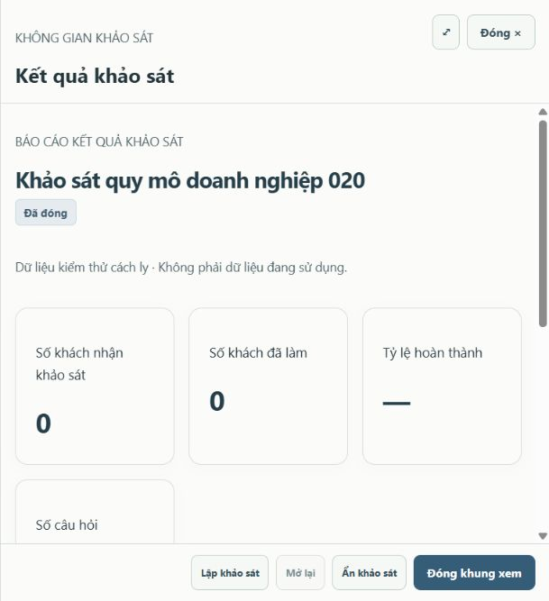
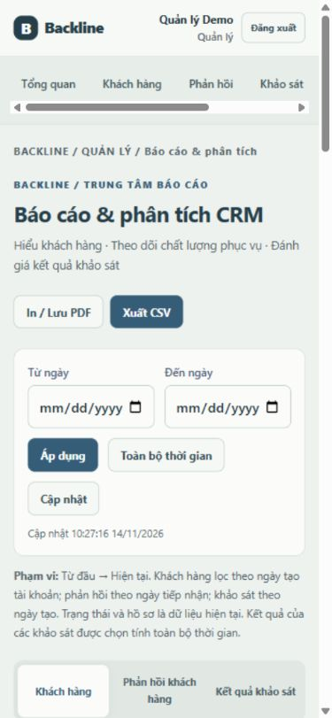
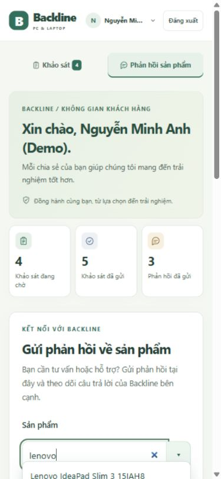

# Báo cáo đánh giá toàn diện Backline CRM

Ngày kiểm tra: **14/11/2026**. Phạm vi: phiên bản mã nguồn đang có trong workspace, bao gồm các thay đổi chưa commit của chủ dự án. Đây là **giai đoạn đánh giá**, chưa sửa mã nguồn chức năng và chưa thay dữ liệu thật.

## 1. Kết luận để ra quyết định

**Các nghiệp vụ chính đã có xử lý thật và phần lớn chạy được trong môi trường kiểm thử. Chưa nên mở hệ thống cho người dùng thật qua Internet với cấu hình khởi động hiện tại.** Điểm chặn lớn nhất là server vẫn có thể tự tạo tài khoản Admin với mật khẩu mẫu trong chế độ production. Các điểm cần xử lý tiếp theo liên quan đến khóa JWT yếu, giới hạn đăng nhập, mật khẩu dài, log chứa dữ liệu nhạy cảm, phiên sau đăng xuất và đồng bộ giao diện khi đổi tài khoản.

Không có cơ sở đưa ra một tỷ lệ như “hoàn thiện 95%”: chưa có bộ tiêu chí nghiệm thu sản phẩm thực tế, số người dùng đồng thời và yêu cầu vận hành chính thức. Kết luận phù hợp hơn là: **đủ nền tảng trình diễn đồ án và thử nghiệm nghiệp vụ; còn thiếu các điều kiện bảo mật, dữ liệu và vận hành để nghiệm thu sản phẩm thực tế**.

Tổng hợp **19 vấn đề/điểm cần cải thiện**: **1 CRITICAL, 4 HIGH, 10 MEDIUM, 4 LOW**. Mức CRITICAL gắn với điều kiện triển khai: server kết nối database chưa có Admin và cổng đăng nhập có thể được người ngoài truy cập. Không khẳng định đã có người khai thác hệ thống thật.

Các chức năng được kiểm tra không chỉ có giao diện: đăng ký, tạo khách, lưu hồ sơ, gửi/sửa/xóa phản hồi, trả lời của Quản lý, chu kỳ khảo sát và báo cáo đều có API và thao tác database. **Chưa tìm thấy nút “trang trí” không có nghiệp vụ trong các luồng đã rà soát.** Điều này không đồng nghĩa mọi nút trên mọi trình duyệt đã được bấm thử.

## 2. Môi trường, phương pháp và giới hạn

- Công nghệ: Node.js/CommonJS, Express, MySQL/mysql2, bcryptjs, JWT; frontend HTML/CSS/JavaScript thuần. Ba vai trò: Khách hàng, Quản lý, Admin.
- MySQL80 của dự án đang **tắt** tại thời điểm kiểm tra. Không khởi động hoặc sửa database đang sử dụng của chủ dự án.
- Dùng MySQL riêng tại loopback `127.0.0.1:33307`; tạo database audit ngẫu nhiên, server HTTP cổng ngẫu nhiên và dữ liệu giả lập. Database audit được xóa sau kiểm tra. Không dùng tài khoản thực để thử mật khẩu hay tạo/xóa nghiệp vụ.
- `npm test`: **187/187 kiểm thử đạt**. Kiểm tra HTTP/MySQL vòng đời khảo sát: **231 kiểm tra đạt**. Kiểm tra workspace quy mô 100 khảo sát: **36 kiểm tra đạt**, gồm 25 mở, 25 đóng, 50 nháp, phân trang và bộ lọc. Các con số là số kiểm tra của từng bộ, không phải số chức năng độc lập.
- Thực hiện thêm probe âm tính và tình huống ngoài bộ test; kết quả tại `outputs/qa/audit-20261114/probe-results.json`. Các lỗi bên dưới vẫn tồn tại dù bộ test hồi quy đạt.
- Trình duyệt: đăng nhập đủ ba vai trò trên server audit; xem danh sách/chi tiết khảo sát cuối trang; mở biểu mẫu tạo khách của Admin; xem báo cáo màn hình nhỏ; tìm sản phẩm `lenovo` phía khách. Kiểm tra viewport 390×844; không phải kiểm định toàn bộ thiết bị di động hoặc công nghệ hỗ trợ.
- Không kiểm thử xâm nhập qua Internet, không đánh giá TLS/reverse proxy thực tế, không benchmark nhiều người dùng đồng thời, chưa thực hiện diễn tập phục hồi thảm họa hoặc quét toàn bộ thư viện theo cơ sở CVE trực tuyến. Không suy diễn rằng những phần này đã đạt.
- Không thay README, `.env`, mã nguồn nghiệp vụ, cấu trúc database thật hoặc nội dung dữ liệu thật. Những file báo cáo và script probe mới chỉ nằm trong `docs/` và `outputs/qa/audit-20261114/`.

### Hồ sơ bằng chứng

| File trong `outputs/qa/audit-20261114/` | Nội dung |
|---|---|
| `unit-tests.txt` | Kết quả 187 kiểm thử tự động |
| `lifecycle-db.txt` | Kết quả 231 kiểm tra HTTP/MySQL |
| `probe.cjs`, `probe-results.json`, `probe-run.txt` | Tái hiện các trường hợp bảo mật, dữ liệu, hàng đợi |
| `frontend-race.cjs`, `frontend-race-results.json` | Chạy hàm gửi phản hồi thực tế trong VM với API trả chậm |
| `source-fingerprints.json`, `source-integrity-check.json` | Đối chiếu SHA-256 các file nguồn được ghi nhận đầu đợt audit |
| `manager-detail.png` | Khung kết quả khảo sát mở từ cuối danh sách |
| `reports-mobile.png` | Báo cáo ở màn hình nhỏ |
| `customer-search-mobile.png` | Gợi ý Lenovo trong biểu mẫu phản hồi |

Các file bằng chứng không chứa JWT, mật khẩu `.env` hoặc mã khôi phục thật. Probe ghi nhận việc log có chứa chuỗi mật khẩu giả bằng giá trị boolean, không xuất mật khẩu đó vào báo cáo.

## 3. Kiến trúc và phân quyền đã xác minh

```text
Khách: index.html / app.js + các module customer-*
Admin: admin.html / admin.js / role-ui.js / staff-*
Quản lý: manager.html / các module staff-* / reports.js
                     ↓ HTTP JSON
server.mysql.js → middleware xác thực/phân quyền → service/validation
                     ↓ mysql2, transaction khi cần
users, feedback, products, surveys, survey_questions, question_options,
survey_recipients, survey_responses, response_details,
interests, customer_interests, bảng khôi phục mật khẩu và lịch sử
```

Các module nghiệp vụ đáng chú ý: `crm-validation.js`, `birth-date.js`, `survey-service.js`, `survey-lifecycle.js`, `survey-enrollment.js`, `survey-expiry.js`, `feedback-service.js`, `customer-retention.js`, `reports-service.js`, `customer-session.js`, `password-recovery.js`, `recovery-codes.js`.

| Vai trò | Được sử dụng | Bị chặn |
|---|---|---|
| Khách hàng | Hồ sơ chính mình, khảo sát được nhận, phản hồi chính mình, khôi phục mật khẩu khách | API tài khoản, quản lý khách, báo cáo và thao tác quản trị khảo sát |
| Quản lý | Tổng quan, khách hàng, khóa khách, xóa khách đã khóa, phản hồi, khảo sát, báo cáo | Quản trị tài khoản nhân viên/Admin |
| Admin | Danh sách/tạo/xóa tài khoản theo quyền, duyệt khôi phục mật khẩu và lịch sử tương tác | Báo cáo và nghiệp vụ riêng của Quản lý |

Probe thực tế: Khách → accounts: **403**; Quản lý → accounts: **403**; Admin → reports: **403**; chưa đăng nhập → `/api/me`: **401**. Tiền tố `/api/admin/...` là tên kỹ thuật cũ, không có nghĩa mọi API bên dưới đều dành cho Admin; middleware phân biệt theo nhóm đường dẫn. Đây chưa phải lỗi phân quyền.

## 4. Danh mục chức năng và mức hoàn thiện

Quy ước: **Đạt trong phạm vi kiểm tra** = có xử lý thật, có bằng chứng kiểm thử/rà soát phù hợp; **Một phần** = chạy được nhưng có vấn đề cụ thể bên dưới; **Chưa xác minh** = thiếu bằng chứng ở môi trường sử dụng thật. Bảng dưới gom thành **32 nhóm thao tác** để tiện nghiệm thu; không coi mỗi nút, mỗi API hoặc mỗi loại câu hỏi là một chức năng riêng.

| # | Nhóm thao tác | Đánh giá | Ghi chú |
|---|---|---|---|
| 1 | Đăng nhập theo vai trò | Một phần | Vào đúng vai trò; thiếu bảo vệ thử mật khẩu, F02–F04 |
| 2 | Đăng xuất và ghi nhớ đăng nhập | Một phần | Xóa phiên phía trình duyệt; token cũ vẫn dùng được, F06 |
| 3 | Khách tự đăng ký | Một phần | Bắt buộc ngày sinh/giới tính; còn lỗi độ dài, F10 |
| 4 | Bắt buộc hoàn thiện hồ sơ/nhu cầu sau đăng nhập | Một phần | Giao diện có chặn; API chưa kiểm tra toàn bộ hồ sơ, F07 |
| 5 | Cập nhật hồ sơ, nhu cầu, nhiều sở thích | Đạt trong phạm vi kiểm tra | Lưu qua transaction; ngày sinh 0–120 tuổi và giới tính được kiểm tra |
| 6 | Mã khôi phục mật khẩu cá nhân | Đạt trong phạm vi kiểm tra | Hash mã, có hết hạn/giới hạn thử; không phải gửi email tự động |
| 7 | Khách gửi yêu cầu khôi phục thủ công | Đạt trong phạm vi kiểm tra | Trạng thái, token yêu cầu, thời hạn và hoàn tất đổi mật khẩu có xử lý |
| 8 | Admin duyệt/từ chối/theo dõi khôi phục | Một phần | Hàng đợi bị giới hạn 200 bản ghi không phân trang, F12 |
| 9 | Admin xem/tìm/lọc tài khoản | Một phần | API thực; tải toàn bộ, F13 |
| 10 | Admin tạo tài khoản khách | Một phần | Có ngày sinh/giới tính; dùng chung vấn đề mật khẩu dài, F04 |
| 11 | Admin tạo tài khoản Quản lý | Một phần | Có xử lý thật; dùng chung vấn đề mật khẩu dài, F04 |
| 12 | Admin xóa tài khoản theo quyền | Đạt trong phạm vi kiểm tra | Khách được xóa trực tiếp, dữ liệu giữ theo chính sách; không xóa chính mình |
| 13 | Quản lý xem/tìm/lọc khách | Một phần | Hoạt động, chưa có phân trang server đồng bộ quy mô lớn, F13 |
| 14 | Quản lý tạo khách | Đạt trong phạm vi kiểm tra | Ngày sinh dd/mm/yyyy và giới tính bắt buộc; nhu cầu để khách khai báo sau |
| 15 | Quản lý khóa/mở khóa khách | Đạt trong phạm vi kiểm tra | Server kiểm tra trạng thái khi xác thực |
| 16 | Quản lý xóa khách đã khóa | Đạt trong phạm vi kiểm tra | Giữ nghiệp vụ, tên, ngày sinh, giới tính, nhu cầu/sở thích; xóa dữ liệu liên hệ/xác thực theo chính sách |
| 17 | Khách tìm sản phẩm và gửi phản hồi | Một phần | Gợi ý Lenovo hoạt động; nguy cơ gửi trùng/race, F08–F09 |
| 18 | Khách sửa phản hồi | Đạt trong phạm vi kiểm tra | Kiểm tra chủ sở hữu/revision; xóa câu trả lời cũ, chuyển Tiếp nhận |
| 19 | Khách xóa phản hồi | Đạt trong phạm vi kiểm tra | Kiểm tra chủ sở hữu; câu trả lời quản lý gắn với phản hồi cũng bị loại bỏ |
| 20 | Quản lý lọc/xem phản hồi | Một phần | Hai trạng thái nghiệp vụ; tải danh sách lớn còn hạn chế, F13 |
| 21 | Quản lý trả lời/chỉnh sửa trả lời | Đạt trong phạm vi kiểm tra | Có transaction/revision; trả lời → Đã giải quyết |
| 22 | Ẩn/xem lại phản hồi đã giải quyết | Đạt trong phạm vi kiểm tra | Có API và điều kiện trạng thái |
| 23 | Tạo/sửa bản nháp, câu hỏi và phương thức hạn | Một phần | Có bắt buộc phương thức hạn; thiếu giới hạn nội dung, F10 |
| 24 | Chọn phạm vi Tất cả/Bộ lọc/Từng khách | Đạt trong phạm vi kiểm tra | Nhiều sở thích dùng phép khớp bất kỳ; tuổi theo ngày sinh, hai biên được tính |
| 25 | Danh sách khảo sát, trạng thái, tìm chữ/ngày, phân trang, khung xem | Đạt trong phạm vi kiểm tra | 100 khảo sát, tìm/lọc/ngày không hợp lệ, mở cuối danh sách giữ vị trí |
| 26 | Mở/gửi và đồng bộ người nhận | Đạt trong phạm vi kiểm tra | Yêu cầu phạm vi; Tất cả nhận thêm khách mới, phạm vi khác giữ snapshot theo thiết kế |
| 27 | Gia hạn/điều chỉnh kết thúc | Đạt trong phạm vi kiểm tra | Kiểm tra trạng thái và hạn hợp lệ; không mất bài đã gửi |
| 28 | Đóng ngay/tự đóng/khóa khẩn cấp | Đạt trong phạm vi kiểm tra | Hết ngày Việt Nam tự đóng; khóa khẩn cấp chỉ khi chưa có bài gửi |
| 29 | Mở lại khảo sát đóng | Đạt trong phạm vi kiểm tra | Giữ lịch sử/bài gửi, kiểm tra hạn/người nhận; không cho gửi lại bài cũ |
| 30 | Lập khảo sát, xóa nháp, ẩn và xem đã ẩn | Đạt trong phạm vi kiểm tra | Bản sao độc lập; điều kiện xóa/ẩn có kiểm tra |
| 31 | Khách xem/làm/xem câu trả lời và lịch sử khảo sát | Một phần | Quyền và đáp án được kiểm tra; tải câu hỏi dạng N+1, F13 |
| 32 | Báo cáo, cập nhật, kết quả từng câu, CSV, In/PDF | Một phần | Có dữ liệu thật, no-store; phân loại khách xóa chưa hợp lý, F11. Bố cục bản in/PDF mọi trình duyệt chưa xác minh |

Không có nhóm nào được kết luận “hoàn toàn chưa hoạt động” chỉ vì nhìn thấy giao diện. Các điểm không chạy đúng đã được ghi cụ thể dưới đây. Tình trạng trên là của bản kiểm tra; không phải cam kết hiệu năng/SLA.

## 5. Bảng vấn đề tổng hợp

| STT | Trang/Chức năng | Vấn đề phát hiện | Nguyên nhân | Mức độ | Hướng khắc phục |
|---|---|---|---|---|---|
| F01 | Khởi động/triển khai | Production vẫn tự tạo Admin có mật khẩu mẫu | `seed()` chạy không phân biệt môi trường | CRITICAL | Tách seed demo khỏi runtime; bootstrap Admin riêng, bí mật một lần |
| F02 | Cấu hình JWT | Server chấp nhận secret rất ngắn | Chỉ kiểm tra biến có giá trị | HIGH | Kiểm tra độ mạnh, từ chối cấu hình không đạt ở production |
| F03 | Đăng nhập | Không có giới hạn thử mật khẩu tại endpoint | Không có limiter cho login | HIGH | Giới hạn theo tài khoản/IP, backoff, giám sát |
| F04 | Mật khẩu | Hai mật khẩu khác nhau sau 72 byte vẫn đăng nhập được | bcrypt cắt phần vượt 72 byte; validation không đồng nhất | HIGH | Chính sách byte thống nhất tại mọi điểm nhận mật khẩu |
| F05 | Lỗi request/log | JSON sai trả 500 và có thể ghi password vào log | Log toàn bộ error có `body` | HIGH | Phân loại 400/413, log có lọc trường nhạy cảm |
| F06 | Đăng xuất | Token cũ vẫn gọi API được | Chỉ xóa cookie, không thu hồi token | MEDIUM | Thu hồi phiên bằng session id/token version có chính sách rõ |
| F07 | Hồ sơ/API | Hồ sơ thiếu ngày sinh vẫn vào API nếu cờ nhu cầu đã true | Middleware chỉ kiểm tra `need_confirmed` | MEDIUM | Kiểm tra điều kiện hồ sơ dùng chung ở server |
| F08 | Gửi phản hồi | Hai yêu cầu đồng thời tạo hai phản hồi giống nhau | Submit mới chưa khóa; thiếu idempotency | MEDIUM | Chặn gửi lặp UI và idempotency phía server |
| F09 | Phản hồi/đổi phiên | Kết quả request cũ cập nhật vào cache tài khoản mới | Dùng `me.email` sau await, không kiểm tra người khởi tạo | MEDIUM | Chốt owner/phiên; bỏ kết quả khi phiên đã đổi |
| F10 | Đăng ký/tạo khảo sát | Đầu vào dài vượt kiểu cột trả lỗi 500 | Thiếu giới hạn tương ứng schema | MEDIUM | Validation chung + thông báo 400 rõ ràng |
| F11 | Báo cáo khách | Khách đã xóa bị tính là khóa và thiếu hồ sơ có thể bổ sung | Không phân biệt `erased_at` khi tổng hợp | MEDIUM | Giữ lịch sử nhưng tách nhóm đã xóa và mẫu số chất lượng hồ sơ |
| F12 | Khôi phục mật khẩu | Yêu cầu cũ không thể được thấy khi vượt 200 bản ghi mới | LIMIT 200, không có phân trang server | MEDIUM | Phân trang/lọc server, ưu tiên yêu cầu đang chờ |
| F13 | Danh sách/quy mô | Nhiều màn tải hết dữ liệu; khảo sát khách truy vấn N+1 | Chưa đồng bộ cách phân trang/batch | MEDIUM | Phân trang server, truy vấn gom, đo tải thực tế |
| F14 | Xác thực/kết nối DB | Sự cố DB trong middleware bị báo thành phiên hết hạn | catch gộp lỗi JWT và lỗi hạ tầng | MEDIUM | Tách lỗi xác thực và 503, không tự đẩy người dùng ra vì DB lỗi |
| F15 | Báo cáo/ngày giờ | Mốc ngày phụ thuộc timezone MySQL thay vì quy ước Việt Nam | `CURDATE()` theo session DB | LOW | Đồng bộ timezone và truyền mốc ngày nghiệp vụ |
| F16 | Toàn vẹn chi tiết đáp án | DB chấp nhận question và response khác khảo sát khi ghi trực tiếp | FK đơn lẻ không biểu diễn đủ quan hệ | LOW | Ràng buộc ghép/kiểm định import và migration dữ liệu |
| F17 | Danh mục sản phẩm | Danh mục cố định nhiều nơi, DB không phải nguồn chung | Frontend PRODS và catalog server đóng cứng | LOW | API sản phẩm đang dùng, một nguồn danh mục |
| F18 | Giao diện ngày | Một số bộ lọc hiển thị mm/dd/yyyy trong trình duyệt kiểm tra | Dùng input date bản địa, thiếu chỉ dẫn nhất quán | LOW | Nhãn rõ quy ước/địa phương hóa và kiểm thử locale |
| F19 | Seed khách mặc định | Đường khởi động schema trống tạo khách thiếu ngày sinh | Seed cơ bản dùng birth_year, không birth_date | MEDIUM | Dùng builder hợp lệ duy nhất; không tự tạo demo ở production |

## 6. Phân tích và điều kiện xác nhận đạt từng vấn đề

### F01 — Admin mặc định được tạo cả khi NODE_ENV=production

- **Hiện trạng/bằng chứng:** `server.mysql.js:135` bắt đầu hàm `seed()`, tạo Admin khi chưa có role ADMIN; khối khởi động cuối file vẫn gọi seed. Probe `EMPTY_PRODUCTION_STARTUP` trên schema trống, NODE_ENV=production: đăng nhập bằng tài khoản Admin mẫu trả **200**. Server dùng `app.listen(PORT)` (`server.mysql.js:973`), không giới hạn riêng loopback bằng tham số host.
- **Vấn đề/tác động:** nếu triển khai theo cách đó và endpoint có thể truy cập, người biết mật khẩu demo có thể vào quản trị. Đây là điều kiện cấu hình/khởi động nguy hiểm, không phải kết luận môi trường hiện tại đang công khai ra Internet. README đã cảnh báo dùng demo local nhưng runtime chưa cưỡng chế điều đó.
- **Giải pháp:** runtime chỉ kiểm tra schema/config và chạy nghiệp vụ; seed demo qua lệnh riêng, production từ chối chạy demo seed. Tạo Admin đầu tiên bằng luồng bootstrap riêng với bí mật sinh ngẫu nhiên/cấp một lần và quy trình đổi mật khẩu; không log bí mật. Không đưa mật khẩu mới vào Git.
- **Phạm vi sửa:** `server.mysql.js`, các script setup/seed, cấu hình deploy; xem lại vòng đời mật khẩu Admin/nhân viên vì giao diện hiện chưa cung cấp luồng tự đổi mật khẩu đầy đủ cho hai vai trò này.
- **Kiểm thử xác nhận đạt:** production database trống không tự xuất hiện tài khoản mẫu; thông tin demo không đăng nhập được; bootstrap có hướng dẫn và chạy một lần; demo local vẫn tạo được khi người vận hành chủ động yêu cầu. Thử cả DB có dữ liệu và DB trống.

### F02 — Khóa ký JWT yếu không bị từ chối

- **Hiện trạng/bằng chứng:** `server.mysql.js:26–30` chỉ kiểm tra `if (!secret)`. Probe production dùng một secret ngắn và vẫn khởi động/đăng nhập thành công.
- **Vấn đề/tác động:** cấu hình yếu được chấp nhận; nếu người triển khai dùng secret dễ đoán, token có nguy cơ bị giả mạo. Không khẳng định secret trong `.env` thật hiện đang yếu.
- **Giải pháp:** yêu cầu khóa ngẫu nhiên đủ mạnh; kiểm tra độ dài byte tối thiểu và từ chối giá trị ví dụ/dễ đoán trong production. Script config đang sinh ngẫu nhiên nên cần giữ cách đó và bổ sung kiểm tra lúc chạy. Không chỉ đo độ dài rồi coi là có đủ entropy.
- **Phạm vi sửa:** cấu hình khởi động, `server.mysql.js`, script tạo `.env`, tài liệu triển khai riêng khi được phép.
- **Kiểm thử:** rỗng, ngắn, giá trị mẫu đều làm production dừng với thông báo không lộ secret; khóa ngẫu nhiên hợp lệ chạy được; có kịch bản thay khóa/đăng nhập lại.

### F03 — Login chưa giới hạn thử sai

- **Hiện trạng/bằng chứng:** route `POST /api/auth/login`, `server.mysql.js:240`; 10 lần mật khẩu sai liên tiếp đều trả 401, không có 429/backoff. Rà soát route không thấy limiter; limiter của khôi phục không bảo vệ login.
- **Vấn đề/tác động:** thuận lợi cho dò mật khẩu và tiêu hao CPU bcrypt. Mười lần là ca thử tái hiện; kết luận không có limiter dựa thêm vào mã nguồn, không chỉ dựa vào con số 10.
- **Giải pháp:** giới hạn kết hợp IP/tài khoản, thời gian chờ tăng dần, thông báo không tiết lộ tài khoản tồn tại; tránh khóa vĩnh viễn để kẻ xấu gây từ chối dịch vụ. Nếu nhiều instance cần kho giới hạn dùng chung và cấu hình proxy đúng.
- **Phạm vi sửa:** middleware login, cấu hình proxy, ghi nhận sự kiện xác thực.
- **Kiểm thử:** chạm ngưỡng → 429/thời gian chờ; hết cửa sổ thử lại được; tài khoản khác không bị chặn hàng loạt; tài khoản không tồn tại có phản hồi tương đương; thử qua reverse proxy dự kiến sử dụng.

### F04 — Mật khẩu dài bị đồng nhất sau 72 byte

- **Hiện trạng/bằng chứng:** probe tạo khách bằng chuỗi 72 byte cộng hậu tố X; đăng nhập bằng cùng 72 byte cộng hậu tố Y vẫn trả **200**. Những route tạo tài khoản/đăng ký băm bcrypt mà chưa kiểm tra giới hạn này; `password-recovery.js:40` lại đã giới hạn 72 byte.
- **Vấn đề/tác động:** mật khẩu người dùng nghĩ là khác nhau thực tế có cùng ý nghĩa; chính sách tạo/đăng nhập/khôi phục không nhất quán. Độ dài ký tự không thay thế độ dài UTF-8 khi có tiếng Việt/emoji.
- **Giải pháp:** trước mắt giữ bcrypt, thống nhất giới hạn 72 byte tại mọi điểm nhận mật khẩu và phản hồi dễ hiểu. Đánh giá tài khoản cũ có mật khẩu dài trước khi áp dụng, tránh khóa người dùng ngoài ý muốn. Không tự cắt chuỗi trên giao diện.
- **Phạm vi sửa:** đăng ký, login, Admin/Quản lý tạo tài khoản, các module khôi phục và trường mật khẩu frontend.
- **Kiểm thử:** 71/72/73 byte, tiếng Việt/emoji, hai hậu tố khác nhau, mọi cổng đăng nhập; xác nhận mật khẩu vượt giới hạn bị từ chối rõ ràng thay vì âm thầm nhận.

### F05 — JSON lỗi có thể ghi mật khẩu vào log

- **Hiện trạng/bằng chứng:** `server.mysql.js:42` dùng JSON parser, error handler tại `server.mysql.js:931` chỉ xử lý InputError/duplicate rồi `console.error(err)` ở dòng 935. Probe gửi JSON hỏng chứa mật khẩu giả: HTTP **500**, log child process chứa chuỗi mật khẩu giả (`syntheticPasswordAppearsInServerLog: true`). Không ghi lại nội dung log thô trong bằng chứng công khai.
- **Vấn đề/tác động:** lỗi cú pháp của client bị coi là lỗi máy chủ; body có thể nằm trong đối tượng lỗi và lộ qua log/thu thập log. Đây là bằng chứng dữ liệu giả, không có kết luận đã lộ mật khẩu thật.
- **Giải pháp:** xử lý lỗi parser 400, body quá lớn 413; log có cấu trúc với mã lỗi/request id và danh sách trường được phép. Không log password, authorization, cookie, mã/token khôi phục hoặc raw body.
- **Phạm vi sửa:** JSON/error middleware, quy ước logger và cấu hình lưu log.
- **Kiểm thử:** JSON sai, payload >1 MB, lỗi SQL giả lập; status đúng; tìm marker mật khẩu giả trong stdout/stderr/log sink đều không có; thông báo người dùng không nhắc cấu hình nội bộ không cần thiết.

### F06 — Đăng xuất chưa thu hồi token đã cấp

- **Hiện trạng/bằng chứng:** `server.mysql.js:275` gọi `CustomerSession.clear`; probe logout trả 200 nhưng dùng lại Bearer token cũ gọi `/api/me` vẫn **200**. JWT có hạn dùng và auth_version được so sánh; logout chưa thay đổi trạng thái xác thực ở server.
- **Vấn đề/tác động:** cookie bị xóa trên máy đang dùng nhưng bản token đã bị sao chép vẫn có thể dùng đến hạn hoặc khi version/trạng thái đổi. Đây là giới hạn của cách logout hiện tại, không phải API bỏ qua chữ ký JWT.
- **Giải pháp:** định nghĩa đăng xuất một phiên hay mọi phiên; lưu session id/token id để thu hồi riêng, hoặc dùng auth_version nếu chấp nhận thoát mọi thiết bị. Ưu tiên không làm gián đoạn phiên khác ngoài ý muốn.
- **Phạm vi sửa:** `customer-session.js`, tokenFor/auth/logout, bảng quản lý phiên nếu chọn phương án đó, logic đăng xuất staff.
- **Kiểm thử:** token của phiên vừa logout trả 401; phiên khác theo đúng chính sách; remember-me và cookie bị xóa đúng; thay mật khẩu/khóa/xóa tiếp tục vô hiệu hóa truy cập.

### F07 — API chưa bảo đảm toàn bộ điều kiện hồ sơ

- **Hiện trạng/bằng chứng:** `server.mysql.js:95` chỉ dùng `need_confirmed` để chặn nhóm feedback/surveys. Trong DB audit, giữ cờ true nhưng đặt ngày sinh NULL: API khảo sát và phản hồi vẫn **200**. Sau probe đã khôi phục dữ liệu audit.
- **Vấn đề/tác động:** khách cũ/import/migration có cờ xác nhận nhưng thiếu trường bắt buộc vẫn qua server; frontend có màn yêu cầu bổ sung nhưng gọi API trực tiếp có thể vượt điều kiện. Không khẳng định đăng ký mới hiện có thể bỏ trống ngày sinh — route đăng ký đã chặn.
- **Giải pháp:** một hàm kiểm tra “đủ điều kiện sử dụng” dùng chung, kiểm tra ngày sinh hợp lệ, giới tính, nhu cầu đã chủ động xác nhận và các trường nghiệp vụ yêu cầu; trả code lỗi cùng danh sách trường thiếu để UI điều hướng vào hồ sơ sau khi đăng nhập thành công.
- **Phạm vi sửa:** auth/middleware onboarding, `crm-validation.js`, `customer-need.js`, `app.js`, kiểm định dữ liệu cũ. Sở thích vẫn có thể rỗng nếu quy định hiện tại không bắt buộc.
- **Kiểm thử:** thiếu từng trường với `need_confirmed=true/false`; API trả 403 mã nghiệp vụ, không báo sai mật khẩu; lưu đủ hồ sơ rồi truy cập được; lịch sử/quyền xem dữ liệu theo chính sách đã chọn.

### F08 — Có thể tạo phản hồi trùng khi gửi lặp

- **Hiện trạng/bằng chứng:** hai POST giống nhau đồng thời trả **201/201**, tạo hai ID. `app.js:689–718` chỉ khóa nút khi `formId === 'fbEdit'`; tạo phản hồi mới chưa có pending guard tương tự.
- **Vấn đề/tác động:** nhấp đúp/mạng chậm tạo hai bản ghi, làm tăng số việc tiếp nhận và sai số báo cáo. Không nên cấm khách phản hồi nhiều lần về cùng sản phẩm vì có thể là các việc khác nhau; lỗi nằm ở lần gửi bị lặp ngoài ý muốn.
- **Giải pháp:** khóa gửi khi request đang chạy; mỗi lần gửi có idempotency key để server trả lại kết quả cũ nếu retry. Không dùng UNIQUE(customer,product) vì sẽ chặn nghiệp vụ hợp lệ.
- **Phạm vi sửa:** submit feedback, `POST /api/feedback`, cơ chế idempotency và ràng buộc tương ứng.
- **Kiểm thử:** double click, hai request cùng key, timeout rồi retry, hai phản hồi thực sự khác key; chỉ tình huống gửi lặp tạo một bản ghi.

### F09 — Request phản hồi cũ cập nhật nhầm phiên giao diện

- **Hiện trạng/bằng chứng:** `app.js:634–653`, sau `await api(...)` dùng trực tiếp `FB[me.email]`. Probe VM trích chính hàm này: đăng xuất trước lúc trả về gây TypeError; đổi từ A sang B trước lúc trả về làm dữ liệu phản hồi A được thêm vào cache B. File `frontend-race-results.json` ghi cả hai kết quả true.
- **Vấn đề/tác động:** giao diện có thể hiển thị phản hồi của phiên trước khi tài khoản khác đăng nhập trên cùng trang. DB vẫn gắn phản hồi với `req.user.id` ban đầu; chưa thấy việc ghi sai chủ sở hữu trong DB từ ca này.
- **Giải pháp:** chụp owner id + mã thế hệ phiên trước await; trước mọi cập nhật cache/render kiểm tra phiên còn trùng. Có thể abort request khi logout, nhưng vẫn cần kiểm tra kết quả vì server có thể đã hoàn tất.
- **Phạm vi sửa:** `H.fb`, cơ chế login/logout và các handler async tương tự; tham khảo `H.fbEdit` đã có kiểm tra owner.
- **Kiểm thử:** giữ POST chậm, logout/đổi tài khoản rồi trả response; không lỗi, không cache/notification nhầm; người A đăng nhập lại vẫn xem được phản hồi đã lưu thật.

### F10 — Giới hạn đầu vào chưa khớp database

- **Hiện trạng/bằng chứng:** đăng ký tên 121 ký tự hợp lệ ở các trường khác trả **500**; câu hỏi 18.000 emoji (72.000 byte UTF-8) trả **500** khi ghi cột TEXT. Probe xác nhận transaction tạo khảo sát rollback, số khảo sát không tăng.
- **Vấn đề/tác động:** người dùng nhận thông báo chung về MySQL/.env thay vì biết sửa trường nào. Transaction giảm nguy cơ lưu dở, nhưng không thay thế validation. `crm-validation.js:81–121` giới hạn tiêu đề/số câu/số lựa chọn, chưa giới hạn mô tả và văn bản câu hỏi tương ứng kiểu cột.
- **Giải pháp:** thống nhất độ dài tên/email và các trường text ở server/frontend; cân nhắc giới hạn nghiệp vụ thấp hơn trần TEXT, kiểm tra byte UTF-8 nếu dùng trần lưu trữ. Giữ transaction và rollback.
- **Phạm vi sửa:** route register, `crm-validation.js`, biểu mẫu tạo/sửa khảo sát, schema chỉ khi có lý do mở rộng thật.
- **Kiểm thử:** ngay dưới/đúng/vượt biên, chữ Việt/emoji; trả 400 có tên trường; không dữ liệu dở; payload hợp lệ vẫn lưu đúng.

### F11 — Báo cáo cần tách khách đã xóa khỏi khách khóa/thiếu hồ sơ đang quản lý

- **Hiện trạng/bằng chứng:** `reports-service.js:237` không chọn `erased_at`; bộ tổng hợp ở dòng 43–57 tính locked theo account_status và completeness theo địa chỉ. Probe trước/sau xóa: tổng giữ 19, locked **0→1**, complete **18→17**, tỷ lệ **94,7%→89,5%**. 19 gồm 18 khách mẫu và một khách probe; không phải số khách của database thật.
- **Vấn đề/tác động:** việc xóa đúng chính sách làm địa chỉ bị xóa, sau đó báo cáo hiểu thành hồ sơ cần bổ sung; người dùng có thể nhầm tài khoản đã xóa là tài khoản khóa có thể mở lại. Việc giữ dữ liệu nghiệp vụ/lịch sử là yêu cầu đúng, không đề xuất xóa chúng.
- **Giải pháp:** thêm trạng thái báo cáo “Đã xóa/Lưu trữ”; vẫn tính lịch sử theo chính sách, nhưng phân biệt mẫu số khách hiện hành và hồ sơ lưu trữ; chỉ cảnh báo cần bổ sung cho khách còn quản lý được. Nhãn và CSV phải nói rõ mẫu số.
- **Phạm vi sửa:** `reports-service.js`, `reports.js`, CSV, test báo cáo; dùng `users.erased_at`, không bỏ dữ liệu khảo sát/phản hồi đã giữ.
- **Kiểm thử:** đủ hồ sơ→khóa→xóa; lịch sử/số bài không mất, nhóm archive tăng, cảnh báo bổ sung không tăng vì chủ động xóa; tài khoản xóa không quay lại danh sách nghiệp vụ.

### F12 — Hàng đợi khôi phục không xem được yêu cầu cũ vượt 200 bản ghi

- **Hiện trạng/bằng chứng:** `password-recovery.js:61` lấy mới nhất `LIMIT 200`; counts ở dòng 62 tính tất cả. Probe có **202 pending**, trả **200**, yêu cầu pending cũ nhất không có trong danh sách.
- **Vấn đề/tác động:** badge và danh sách không khớp; yêu cầu còn hiệu lực có thể bị che khỏi Admin khi phát sinh nhiều yêu cầu mới. Không có API phân trang để giao diện lấy phần còn lại.
- **Giải pháp:** phân trang/lọc trạng thái ở server; mặc định ưu tiên PENDING chưa hết hạn và sắp xếp hợp lý; lịch sử ở tab riêng có paging. Không chỉ tăng LIMIT.
- **Phạm vi sửa:** API recovery list, `recovery-admin.js`, index nếu đo truy vấn cho thấy cần.
- **Kiểm thử:** >200 yêu cầu trộn trạng thái; đi hết các trang không thiếu/trùng; pending/expired/completed counts đúng; phê duyệt một yêu cầu cũ còn hiệu lực được.

### F13 — Kiến trúc tải danh sách chưa đồng bộ cho quy mô doanh nghiệp

- **Hiện trạng/bằng chứng:** khảo sát staff đã phân trang thật, 36 kiểm tra quy mô 100 đạt. Ngược lại, một số danh sách accounts/customers/feedback lấy toàn bộ và lọc ở client. `server.mysql.js:557–604` tải khảo sát khách bằng vòng lặp lần lượt truy vấn từng khảo sát và từng câu hỏi; báo cáo chọn tập dữ liệu rồi tổng hợp trong JS.
- **Vấn đề/tác động:** số truy vấn, thời gian chờ và bộ nhớ tăng theo số bản ghi/câu hỏi. Đây là điểm thiết kế xác định qua mã nguồn; **chưa đo và không kết luận hệ thống chậm ở một số lượng cụ thể**.
- **Giải pháp:** phân trang/filter/sort server cho danh sách lớn; lấy questions/options theo batch rồi nhóm trong bộ nhớ; giới hạn tải chi tiết khi người dùng mở bài; tổng hợp SQL khi phù hợp và thêm index dựa EXPLAIN. Dùng cách phân trang khảo sát hiện có làm chuẩn UI.
- **Phạm vi sửa:** list API, `staff-*`, `/api/surveys`, `reports-service.js`, index có bằng chứng cần thiết.
- **Kiểm thử:** dataset tăng dần, đo số query/thời gian/bộ nhớ với số người dùng đồng thời dự kiến; kết quả/counters không sai; trang rỗng/trang cuối và filter giữ ổn định. Chốt ngưỡng chấp nhận trước benchmark.

### F14 — Lỗi database trong auth bị biến thành lỗi phiên

- **Hiện trạng/bằng chứng:** khối try/catch của `auth`, `server.mysql.js:80–109`, bao cả JWT verify, SELECT user và attach interests; mọi exception đều trả 401 “Phiên đăng nhập không hợp lệ hoặc đã hết hạn”. Đây là phát hiện từ mã nguồn, chưa ngắt MySQL của người dùng để tái hiện.
- **Vấn đề/tác động:** lỗi kết nối/query có thể khiến giao diện tưởng người dùng hết phiên, khó hỗ trợ và dễ mất thao tác đang nhập; đăng nhập lại không giải quyết nguyên nhân hạ tầng.
- **Giải pháp:** chỉ bắt lỗi xác thực trong phạm vi JWT; lỗi DB chuyển middleware hạ tầng trả 503/request id; UI giữ nội dung và cho thử lại khi phù hợp, không tự coi đó là sai mật khẩu.
- **Phạm vi sửa:** auth, error middleware, API client, UI lỗi/loading.
- **Kiểm thử:** giả lập DB timeout ở SELECT user và Interests.attach trên môi trường test; 503 và thông báo phù hợp; token hết hạn thật vẫn 401; người dùng không vượt được kiểm tra khi DB lỗi.

### F15 — Mốc ngày báo cáo còn phụ thuộc timezone DB

- **Hiện trạng/bằng chứng:** `reports-service.js:235` lấy ngày bằng `CURDATE()`; tự đóng khảo sát dùng quy ước ngày Việt Nam trong module nghiệp vụ. Nếu timezone session MySQL khác UTC+7, hai mốc có thể khác nhau quanh nửa đêm. Chưa ghi nhận sai ngày trên database thật.
- **Vấn đề/tác động:** có rủi ro sai nhóm tuổi đúng ngày sinh hoặc mốc báo cáo khi chuyển môi trường. Xếp LOW vì là rủi ro triển khai có điều kiện, chưa có lỗi quan sát được ở máy hiện tại.
- **Giải pháp/phạm vi:** thống nhất mốc ngày Việt Nam từ service hoặc cấu hình timezone rõ ràng; rà soát `reports-service.js`, helper ngày và các timestamp giao diện.
- **Kiểm thử:** DB session UTC/UTC+7, thời điểm trước/sau 00:00 Việt Nam, đúng ngày sinh và sát ngày hết hạn; kết quả nghiệp vụ không phụ thuộc timezone máy chủ.

### F16 — FK chi tiết câu trả lời chưa đủ biểu diễn quan hệ khảo sát

- **Hiện trạng/bằng chứng:** `database/schema.sql:134–143` có FK riêng response/question/option. Probe SQL trực tiếp tạo detail có response khảo sát A và question khảo sát B, DB chấp nhận. API hiện có `crm-validation.answers` kiểm tra đáp án thuộc câu, nên **không kết luận client bình thường vượt được qua API này**.
- **Vấn đề/tác động:** script import/migration hoặc code mới ghi sai vẫn có thể tạo liên kết sai ngữ nghĩa dù không có hàng mồ côi theo FK đơn.
- **Giải pháp/phạm vi:** cân nhắc key ghép/thiết kế ràng buộc có survey/question tương ứng; bổ sung kiểm định dữ liệu trước import và truy vấn phát hiện sai. Không sửa schema hàng loạt khi chưa kiểm tra dữ liệu hiện có.
- **Kiểm thử:** API lẫn import từ chối question khác survey, option khác question; dữ liệu hợp lệ vẫn ghi được; báo cáo không đếm đáp án ngoài khảo sát.

### F17 — Danh mục sản phẩm còn đóng cứng

- **Hiện trạng/bằng chứng:** `app.js:125` có PRODS; server dùng `database/catalog.js` và `products.includes(prod)` tại `server.mysql.js:524`, rồi mới tra bảng products. Thử thêm sản phẩm ngoài catalog trong DB audit: frontend không có gợi ý, POST bị từ chối **400**. Không có bằng chứng sản phẩm tùy ý được server chấp nhận.
- **Vấn đề/tác động:** thêm danh mục vào DB chưa đủ để sử dụng; cần sửa mã nhiều nơi khi doanh nghiệp thay sản phẩm. Đây là hạn chế quản trị danh mục, không phải nút tìm kiếm Lenovo bị hỏng.
- **Giải pháp/phạm vi:** một API đọc danh mục đang sử dụng, lựa chọn bằng product id; đồng bộ trạng thái hoạt động giữa frontend/server/DB; bảo toàn sản phẩm cũ trong lịch sử. Thêm CRUD danh mục chỉ khi phạm vi đồ án cần, không tự mở rộng ngoài yêu cầu.
- **Kiểm thử:** sản phẩm mới xuất hiện không sửa JS; sản phẩm ngừng hoạt động không nhận phản hồi mới nhưng lịch sử vẫn đọc đúng; không có kết quả thì empty state rõ.

### F18 — Định dạng ngày ở các bộ lọc chưa nhất quán

- **Hiện trạng/bằng chứng:** `reports-mobile.png` có ô ngày hiển thị `mm/dd/yyyy`, trong khi các trường ngày sinh và dữ liệu hiển thị dùng dd/mm/yyyy. Input date phụ thuộc trình duyệt/locale; không có bằng chứng API lưu đảo tháng/ngày từ ca này.
- **Vấn đề/tác động:** người quen dd/mm/yyyy có thể nhầm khi nhập tay; ảnh hưởng trải nghiệm, không phải lỗi ngày sinh bỏ kiểm tra.
- **Giải pháp/phạm vi:** thống nhất nhãn/hướng dẫn ngày ở báo cáo và bộ lọc; nếu yêu cầu hiển thị dd/mm/yyyy tuyệt đối, dùng component nhập ngày có parse/validation chung; vẫn dùng ISO khi gửi API. Giữ khả năng bàn phím/chọn lịch.
- **Kiểm thử:** locale vi-VN/en-US, ngày 03/11 và 11/03, bàn phím di động; server nhận đúng ISO, lọc đúng biên đầu/cuối ngày.

### F19 — Seed cơ bản còn tạo khách thiếu ngày sinh

- **Hiện trạng/bằng chứng:** builder V3 hiện tại: **18/18** khách có ngày sinh, giới tính, đã xác nhận nhu cầu và ACTIVE. Tuy nhiên `server.mysql.js:155–173` tự tạo `khach@demo.vn` bằng birth_year, không truyền birth_date. Probe schema trống xác nhận khách này có `birthDate: null`, `needConfirmed: false`.
- **Vấn đề/tác động:** hai đường chuẩn bị dữ liệu cho kết quả khác nhau. Người chạy schema-only rồi start, hoặc DB chưa có email demo, có thể lại thấy nhóm “Chưa có ngày sinh hợp lệ”. Không nên quy lỗi này cho bộ dữ liệu V3 mới đầy đủ.
- **Giải pháp:** xử lý cùng F01: bỏ seed demo khỏi runtime production, dùng builder hợp lệ duy nhất ở setup/demo và kiểm định trường bắt buộc sau seed. Dữ liệu cũ thiếu thông tin cần danh sách bổ sung hoặc chiến lược migration, không tự đoán ngày sinh từ năm sinh.
- **Phạm vi sửa:** `server.mysql.js`, `database/demo-data*.js`, setup/seed/check scripts; không tự nạp đè DB thật.
- **Kiểm thử:** setup thường, setup --empty rồi start, demo setup, DB cũ không có khách demo; không tự tạo hồ sơ thiếu trường; khách mới do Quản lý/Admin tạo vẫn đi qua bước nhu cầu sau login theo thiết kế.

## 7. Kiểm tra luồng liên kết và dữ liệu

### 7.1 Đăng ký → đăng nhập → hoàn thiện hồ sơ → sử dụng

Người dùng nhập họ tên/email/điện thoại/mật khẩu/ngày sinh/giới tính → server kiểm tra → băm mật khẩu → transaction lưu users, mã khôi phục và đồng bộ khảo sát phù hợp → cấp phiên → frontend kiểm tra hồ sơ/nhu cầu → trang hồ sơ → PUT `/api/me` → lưu nhu cầu đã xác nhận và sở thích → cho làm khảo sát/phản hồi. Luồng có xử lý thật; điểm còn hở là F07 và validation dài F10. “Chưa xác định” là một nhu cầu hợp lệ nếu khách chủ động chọn; không nên coi giá trị này là chưa khai báo chỉ vì tên gọi.

### 7.2 Admin/Quản lý tạo khách → khách đăng nhập lần đầu

Form tạo khách không thu thập nhu cầu/sở thích, đúng yêu cầu trước đó. Ngày sinh và giới tính có kiểm tra; ngày sinh quản lý nhập dạng dd/mm/yyyy. Nhu cầu mặc định chưa được xác nhận; khách đăng nhập thành công rồi mới được yêu cầu chủ động chọn/lưu. Không được hiển thị lỗi bổ sung hồ sơ ngay tại form login như thể mật khẩu sai. Cần bổ sung kiểm tra server chung F07 để dữ liệu cũ không vượt bước.

### 7.3 Khách phản hồi → Quản lý trả lời → khách sửa/xóa

Gửi phản hồi → lưu feedback trạng thái Tiếp nhận → Quản lý trả lời, kiểm tra revision → Đã giải quyết → khách sửa làm câu trả lời cũ mất hiệu lực/xóa và quay về Tiếp nhận → khách xóa loại bỏ cả phản hồi và câu trả lời gắn với nó. Các kiểm tra chủ sở hữu và revision có xử lý thật. F08–F09 là các tình huống gửi mới/đổi phiên còn thiếu, không phải toàn bộ cơ chế sửa phản hồi chưa chạy.

### 7.4 Khảo sát → phạm vi → mở → trả lời → đóng/mở lại

Tạo nháp yêu cầu phương thức hạn DATE hoặc MANUAL → chọn phạm vi → mở bằng service có kiểm tra → lưu người nhận → khách được phân công đọc/làm → kiểm tra trạng thái/hạn/đáp án trong transaction → unique `(survey_id,customer_id)` ngăn gửi hai lần → xem kết quả/lịch sử. Hạn DATE tính hết ngày tại Việt Nam; MANUAL không có ngày kết thúc, quản lý đóng. Tự đóng giữ người nhận và bài gửi. Gia hạn/mở lại giữ bài đã gửi; người đã làm không làm lại.

ALL có thể nhận khách mới sau khi khảo sát đã mở. Bộ lọc/từng khách dùng phạm vi theo cơ chế snapshot đã thiết kế, không nên tự biến thành thêm người tùy ý. Bộ lọc nhiều sở thích khớp ít nhất một sở thích được chọn, đồng thời thỏa điều kiện tuổi/nhu cầu; tuổi 15–20 không nhận người ngoài khoảng này. Chỉ khóa khẩn cấp khi chưa có bài gửi để quay lại sửa nháp; giữ cấu hình trước đó. Bộ 231 kiểm tra bao phủ các nhánh này.

Một số khảo sát tổng hợp riêng của fixture 100 được thêm trực tiếp để thử danh sách, không có đầy đủ cấu hình mở lại; nút Mở lại bị vô hiệu với hướng dẫn là đúng điều kiện ở những hàng đó. Không coi trạng thái này là lỗi của dữ liệu tạo từ luồng ứng dụng.

### 7.5 Khóa/xóa khách → danh sách nghiệp vụ → báo cáo

Quản lý phải khóa trước khi xóa; Admin được xóa trực tiếp theo yêu cầu. Xóa logic giữ dữ liệu nghiệp vụ và thông tin được phép giữ; bỏ dữ liệu liên hệ/xác thực, vô hiệu phiên, ẩn khỏi danh sách nghiệp vụ. Báo cáo vẫn giữ lịch sử. Thiếu bước phân loại archive trong báo cáo là F11; không đề xuất phục hồi dữ liệu cá nhân đã chủ động xóa.

### 7.6 Báo cáo cập nhật và khoảng thời gian

Nút Cập nhật fetch dữ liệu lại, có chống cache và bảo vệ thứ tự response để yêu cầu cũ không ghi đè yêu cầu mới. Phạm vi có nhãn giải thích: khách theo ngày tạo tài khoản, phản hồi theo ngày tiếp nhận, khảo sát theo ngày tạo; kết quả khảo sát được chọn tính toàn bộ bài trong khảo sát đó. Đây không phải truy vấn snapshot lịch sử tại thời điểm quá khứ. CSV có escape và chặn ký tự công thức nguy hiểm; không phát hiện lỗ hổng CSV formula injection trong đoạn xuất đã rà soát. In/PDF dựa trình duyệt; chưa nghiệm thu mọi khổ giấy/trình duyệt.

### 7.7 Ràng buộc và transaction

- PK/FK và unique email/phone giúp hạn chế trùng định danh; unique response theo khảo sát/khách bảo vệ một lần gửi.
- Các nghiệp vụ lưu hồ sơ, tạo/sửa/nộp khảo sát và xử lý phản hồi có transaction/khóa hoặc revision phù hợp. Probe nội dung câu hỏi vượt cột xác nhận rollback không tạo khảo sát dở.
- Không tìm thấy SQL injection trong các đoạn truy vấn đã rà soát: tham số được bind, các thành phần truy vấn động quan trọng dùng whitelist. Không biến kết luận này thành bảo đảm toàn dự án không còn lỗ hổng.
- Frontend dùng escape cho nội dung động trong các luồng đã kiểm tra; chưa xác nhận stored XSS. Public-assets có allowlist, không coi việc đặt source cùng thư mục là tự động lộ `.env`/SQL qua web.
- Schema vẫn cho phép birth_date NULL/giới tính rỗng để chứa dữ liệu cũ hoặc tài khoản khác vai trò; vì thế bắt buộc nghiệp vụ cần bảo vệ bằng validation API + kiểm định dữ liệu. Không áp NOT NULL toàn bảng users mà bỏ qua tài khoản nhân viên.
- F16 là quan hệ sai ngữ nghĩa mà FK đơn không ngăn; khác với bản ghi mồ côi. Chưa chạy kiểm định toàn bộ database thật nên không kết luận dữ liệu thật hoàn toàn sạch.

## 8. Giao diện, thông báo và điều hướng

Màu xanh/kiểu thẻ/nhãn vai trò nhìn chung nhất quán; tên tiếng Việt chính trong các màn đã kiểm tra phù hợp. Khảo sát staff có tab trạng thái, bộ lọc ngày, trang 20 dòng mặc định, menu thao tác và khung xem riêng. Khi mở “Xem chi tiết” hàng cuối rồi đóng, `scrollY` vẫn ở khoảng 4282 px, không bị đưa về đầu danh sách. Khung kết quả có số nhận, số đã làm, tỷ lệ, số câu và số trả lời từng câu.

Ở 390×844, báo cáo và khách hàng sắp xếp theo chiều dọc; thanh điều hướng staff cuộn ngang có thể thao tác. Không thấy trang báo cáo tràn ngang toàn tài liệu trong phép đo DOM. Gợi ý `lenovo` hiển thị hai sản phẩm Lenovo tương ứng. Những điều này xác nhận các thao tác đã quan sát, không thay thế kiểm tra toàn bộ mobile, keyboard, screen reader và WCAG.

Loading/chống gửi lặp chưa đồng nhất: sửa phản hồi có khóa nút, gửi mới chưa có (F08). Xử lý lỗi máy chủ chưa phân biệt tốt lỗi client/hạ tầng/xác thực (F05, F10, F14). Nhóm nút xóa/khóa có điều kiện/quyền trong server; không thử xóa dữ liệu thật qua trình duyệt. Nhãn ngày cần điều chỉnh F18.

Ảnh bằng chứng:







## 9. Thứ tự sửa đề xuất và điều kiện nghiệm thu

| Đợt | Phạm vi | Điều kiện để thông qua |
|---|---|---|
| 1 — trước khi công khai | F01–F05 và F19 | Không tự sinh tài khoản demo ở production; secret yếu bị chặn; giới hạn login; mật khẩu có biên rõ; log không chứa bí mật; setup sạch không tạo khách thiếu trường |
| 2 — phiên và tính nhất quán | F06–F10, F14 | Logout có chính sách thu hồi; hồ sơ bắt buộc được server cưỡng chế; gửi phản hồi không trùng/nhầm cache; lỗi dữ liệu/hạ tầng trả mã đúng |
| 3 — báo cáo và quy mô | F11–F13 | Archive có nhóm riêng; hàng đợi >200 xem đủ; list/batch có benchmark theo quy mô được chốt |
| 4 — hoàn thiện và phòng ngừa | F15–F18 | Đồng nhất ngày giờ, kiểm định quan hệ import, danh mục một nguồn, nhãn ngày dễ hiểu |

Mỗi đợt giữ kiến trúc hiện có, thay đổi nhỏ có mục tiêu; chạy kiểm thử tập trung vào lỗi đã sửa và bộ hồi quy liên quan. Không viết lại toàn bộ dự án hoặc seed đè dữ liệu đang dùng.

Để vận hành thật còn cần xác nhận ngoài phạm vi audit local: HTTPS/cookie ở reverse proxy, cấu hình quyền DB tối thiểu thay vì dùng tài khoản quản trị để chạy thường xuyên, quản lý secret, lịch backup và thử restore, giám sát lỗi/dung lượng, log có thời hạn lưu, quy trình cập nhật schema, giới hạn tải đồng thời, trách nhiệm duyệt khôi phục thủ công và quy trình đổi mật khẩu nhân viên/Admin. Đây là **hạng mục chưa nghiệm thu**, không ghi thành lỗi đã tái hiện nếu chưa kiểm tra môi trường triển khai.

## 10. Trạng thái bàn giao

Đã hoàn thành bước rà soát, kiểm thử cách ly và đề xuất hướng sửa. **Chưa áp dụng bản sửa nghiệp vụ nào trong đợt đánh giá này.** Giữ nguyên README và các chỉnh sửa có sẵn của chủ dự án. Chỉ bắt đầu sửa từng nhóm sau khi chủ dự án xác nhận, đúng yêu cầu giai đoạn 8 trong văn bản giao việc.
