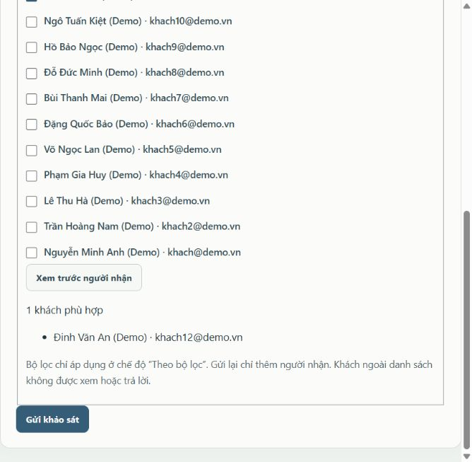

# Kết quả khắc phục theo điều kiện xác nhận đạt

> **Quy trình hiện tại 03/11/2026:** [bắt buộc lưu phạm vi trước khi mở khảo sát](PHAM_VI_BAT_BUOC_KHAO_SAT.md). Phiếu mới không gửi/bổ sung lại sau khi OPEN; chỉ phiếu cũ thiếu phạm vi có ngoại lệ thiết lập một lần. Quy trình này thay các mô tả gửi bổ sung nhiều lần trong các đợt trước.

> **Điều chỉnh bộ chọn người nhận 03/11/2026:** sở thích chọn nhiều, tuổi tròn trong khoảng bao gồm hai đầu mút, nút tải danh sách mở/đóng theo bộ lọc và đã bỏ nút xem trước riêng. Xem [lọc người nhận khảo sát](LOC_NGUOI_NHAN_KHAO_SAT.md). Bộ kiểm thử hiện tại đạt 129/129 và HTTP/MySQL đạt 176/176.

> **Cập nhật 03/11/2026:** người dùng xác nhận phiếu gửi Tất cả cần tự nhận khách đăng ký sau nếu còn OPEN và chưa hết hạn. Quy tắc này thay phần snapshot cố định cho phiếu công khai; phiếu nhóm riêng vẫn giữ snapshot. Xem [đồng bộ cho khách mới](DONG_BO_KHAO_SAT_CHO_KHACH_MOI.md). Bộ kiểm thử mới đạt 125/125 và HTTP/MySQL đạt 172/172.

Ngày nghiệm thu: **01/11/2026**. Dự án: Backline CRM. Tài liệu này cập nhật kết quả thực hiện các mã trong `DANH_GIA_CAC_MUC_CHUA_HOAN_THIEN.md`; không dùng số ca kiểm thử làm tỷ lệ hoàn thiện toàn bộ đồ án.

**Bổ sung cùng ngày:** đã có [Khách hàng xem lại bài khảo sát đã gửi](XEM_LAI_BAI_KHAO_SAT.md), kể cả khi khảo sát đã đóng. Bộ kiểm thử sau bổ sung đạt 121/121 và HTTP/MySQL đạt 167/167; các số 115/115, 163/163 phía dưới lưu kết quả đợt khắc phục ban đầu.

## 1. Ma trận kết quả

| Mã | Kết quả | Điều kiện đã kiểm chứng | Cách dùng / bằng chứng |
| --- | --- | --- | --- |
| BB01 | Đạt về triển khai | Chọn nhiều sở thích, lưu/đọc lại đúng, loại trùng, chặn mã sai; lọc và thống kê khớp SQL | Hồ sơ khách và form thêm khách có sáu sở thích; biểu đồ/CSV tách khỏi nhu cầu chính. Ca nghiệm thu BB01 và unit test |
| BB02 | Đạt về triển khai | Khách trong nhóm thấy/nộp được; ngoài nhóm không thấy và gọi thẳng bị 403; loại khách khóa, sai vai trò, ID sai/trùng; gửi lại không nhân đôi; snapshot và mẫu số báo cáo đúng | Tạo/sửa/mở/gửi dùng chung publisher trong transaction; xem trước và chọn người nhận trên giao diện; ca BB02 |
| BB03 | Đạt | Khôi phục bản sao lưu vào DB mới, khớp số dòng, kiểm tra quan hệ và các luồng đọc chính sau đăng nhập | `scripts/database-backup.js`, hướng dẫn sao lưu và `backup-restore-results.json` |
| CL01 | Đạt theo tiêu chí sửa đã liệt kê | Backend bắt đủ trường hồ sơ; ONE/MULTI/TEXT/RATING đúng kiểu, bắt buộc và lựa chọn; lỗi không ghi dở; đóng/nộp đồng thời theo thứ tự giao dịch hợp lệ | `crm-validation.js`, `survey-service.js`; ca hồi quy và ca CL01; chạy tranh chấp năm lần trên DB cách ly |
| CL02 | Đạt | Có `.env.example`; test dự án chạy; cài mới DB trống và chạy setup lại giữ dữ liệu/mật khẩu | `npm test`, `npm run setup:check` |
| CL03 | Đạt | Form có ngày sinh/giới tính; tạo khách, xem chi tiết và đăng nhập thấy cùng dữ liệu; chặn ngày tương lai; năm sinh suy ra từ ngày sinh | Quản lý → Khách hàng → Thêm khách hàng; ca CL03 |
| CL04 | Đạt | Trước/đúng/sau sinh nhật ở mốc 18/25/35/45 khớp nhóm tuổi và bộ lọc; tổng nhóm đúng tổng khách | `crm-domain.js`, `reports-service.js`; kiểm thử mốc tuổi và dữ liệu thiếu ngày sinh |
| CL05 | Đạt trong phạm vi sửa | Quy tắc sở thích/nhu cầu/tuổi dùng danh mục chung; validation và transaction khảo sát tách riêng; định dạng backend; test hồi quy và tích hợp đạt | Các mô-đun nghiệp vụ riêng, không thêm ORM hoặc framework |
| TC01 | Đạt, mục tùy chọn | Tổng hợp tạo hồ sơ, gửi/trả lời phản hồi, nộp khảo sát; sắp thời gian, phân trang; chỉ Quản lý được xem, không lộ mã/token khôi phục | Khách hàng → Xem chi tiết → Lịch sử tương tác; ca TC01 |
| TL01 | Đã hiệu chỉnh tài liệu; còn cần đối chiếu chính thức | Có bản tự đánh giá mới khớp mã và bằng chứng; chưa có đề bài/rubric gốc để xác nhận tổng yêu cầu, DFD, kế hoạch 15 tuần và phân công nhóm | Đọc `BAO_CAO_TU_DANH_GIA_DA_HIEU_CHINH.md`. File Word tự đánh giá cũ chưa được thay thế; không tiếp tục dùng số “15/17” làm kết luận |

Chín mục kỹ thuật ở trên đã có triển khai và kiểm chứng trong phạm vi nghiệm thu. TL01 còn phần chứng từ đầu vào; không tự xác nhận một tiêu chí học thuật chưa có tài liệu nguồn.

## 2. Những thay đổi nhìn thấy được

### Sở thích và hồ sơ

- Nhu cầu chính giữ một giá trị như trước; sở thích chọn nhiều: Gaming, Đồ họa, Văn phòng, Lập trình, Học tập, Khác.
- Khách vào Thông tin cá nhân, tích sở thích rồi Lưu. Gửi danh sách rỗng là bỏ hết sở thích; không gửi trường sở thích qua API thì giữ dữ liệu hiện có.
- Quản lý có thêm ngày sinh, giới tính và sở thích khi thêm khách. Có thể tạo hồ sơ ban đầu thiếu địa chỉ/ngày sinh/giới tính; giao diện nói rõ khách phải hoàn thiện sau. Khi khách lưu hồ sơ, API yêu cầu đầy đủ các trường này.
- Ngày sinh quản lý nhập qua bộ chọn ngày; năm sinh do server suy ra. API không lấy trường năm sinh riêng để thay đổi ngày sinh.
- Khách cũ chưa có sở thích nằm ở nhóm Chưa khai báo. Migration không tự suy diễn sở thích từ nhu cầu và không nạp lại dữ liệu mẫu vào database hiện tại. Bộ demo cài mới có dữ liệu sở thích giả lập riêng.

### Gửi khảo sát đúng nhóm

1. Tạo khảo sát hoặc vào Gửi khách hàng. Với phiếu OPEN, dùng Bổ sung người nhận.
2. Chọn phạm vi Tất cả / Theo bộ lọc / Chọn từng khách. Theo bộ lọc có nhu cầu, sở thích và khoảng tuổi; tuổi thiếu ngày sinh không khớp bộ lọc tuổi.
3. Chọn bộ lọc rồi bấm Tải danh sách để mở danh sách khách đang hoạt động khớp nhu cầu, ít nhất một sở thích đã chọn và khoảng tuổi. Bấm lần nữa để đóng. Tích người nhận để chọn từng khách.
4. Kiểm tra số lượng, tên, tuổi và sở thích ngay trong danh sách đã lọc. Không còn nút xem trước riêng. Bấm Gửi khảo sát khi đúng đối tượng.
5. Danh sách được chốt lúc gửi. Gửi lại chỉ thêm khách, không loại người cũ hoặc làm mất câu trả lời. Khách đổi hồ sơ về sau không tự mất quyền hoặc được thêm vào một đợt đã gửi.

Tạo hoặc sửa bản nháp thành OPEN cũng dùng bộ chọn này và cùng một transaction ở backend. Phiếu OPEN cũ chưa có người nhận cần Quản lý gửi rõ ràng; không tự mở công khai cho tất cả khách.

Ảnh kiểm tra trực tiếp trên giao diện:

### Báo cáo và lịch sử

- Tuổi tính đủ sinh nhật theo ngày báo cáo MySQL, cùng hàm với bộ lọc. Người sinh 29/02 tăng tuổi vào 01/03 trong năm không nhuận. Chỉ có năm sinh sẽ vào nhóm Chưa có ngày sinh hợp lệ.
- Biểu đồ và CSV có phân bố sở thích; mỗi khách chỉ tính một lần trong mỗi nhóm, tổng tỷ lệ các nhóm có thể vượt 100%.
- Chi tiết khách có lịch sử tương tác, trang 10 sự kiện mặc định; API cho tối đa 50 sự kiện/trang. Nguồn là dữ liệu nghiệp vụ đang lưu, không phải nhật ký bất biến của mọi lần chỉnh sửa hoặc mọi lần đổi trạng thái.
- Phần khôi phục mật khẩu và thông tin xác minh nội bộ không xuất hiện trong lịch sử Quản lý.

## 3. An toàn dữ liệu và tình trạng chạy

Đã sao lưu trước khi thay đổi và kiểm chứng khôi phục. Migration vào `backline_crm` lúc 12:12 ngày 01/11/2026 (UTC+7) thêm `interests`, `customer_interests`; sáu dòng danh mục, chưa có liên kết sở thích cho khách cũ.

| Dữ liệu | Trước | Sau migration |
| --- | ---: | ---: |
| Tài khoản | 15 | 15 |
| Sản phẩm | 14 | 14 |
| Phản hồi | 36 | 36 |
| Khảo sát | 6 | 6 |
| Câu hỏi | 15 | 15 |
| Lựa chọn | 27 | 27 |
| Người nhận | 55 | 55 |
| Lượt trả lời | 17 | 17 |
| Chi tiết trả lời | 52 | 52 |

Cả 12 bảng cũ giữ nguyên số bản ghi; đối chiếu đầy đủ trong `outputs/qa/migration-results.json`. Không đổi mật khẩu hoặc tự ghi sở thích cho khách hiện có. Máy chủ cổng 3000 đã được khởi động lại để nhận mã mới; tải lại trình duyệt để nhận các tệp JavaScript mới.

## 4. Kiểm thử và cách chạy lại

- `npm test`: **115/115 đạt**, gồm validator, tuổi, báo cáo, phân quyền và giao diện mô phỏng. Nhật ký: `outputs/qa/tests-acceptance-final.txt`.
- `node outputs/qa/detailed-system-check.cjs`: **163/163 đạt**, HTTP và SQL thật trên database ngẫu nhiên riêng; tự tạo server/cổng cách ly và tự dọn database. Cần quyền CREATE/DROP DATABASE cho database thử này. Xem `outputs/qa/detailed-results.json` để biết từng ca của lần chạy cuối.
- `npm run setup:check`: đã chạy đạt, kiểm tra tạo schema, nạp 15 tài khoản/6 khảo sát, chạy lại không ghi đè dữ liệu hoặc mật khẩu.
- `outputs/qa/backup-restore-results.json`: bản sao lưu sau migration khôi phục đủ **14 bảng**, đăng nhập và các luồng đọc đạt; kết quả bản trước migration 12 bảng giữ ở `backup-restore-pre-migration-results.json`.
- Đã mở giao diện cổng 3000 bằng trình duyệt: đăng nhập Quản lý, thấy các trường mới, đọc lịch sử, chọn một khách và xem trước đúng một người. Các ca ghi dữ liệu nghiệm thu chạy trong DB cách ly.

Không cộng các số test thành tỷ lệ hoàn thiện đồ án. Test đạt chứng minh phạm vi đã thử; không thay cho việc đối chiếu toàn bộ đề bài, kiểm tra triển khai nhiều máy hoặc kiểm thử tải lớn.

## 5. Các việc còn cần tài liệu gốc

Đối chiếu rubric/đề bài chính thức; cập nhật sơ đồ DFD, kế hoạch 15 tuần và phân công nhóm nếu chúng thực sự là yêu cầu. Bản tự đánh giá mới giữ các mục này ở trạng thái chưa đủ bằng chứng. Giao diện hiện có chế độ sáng, chưa có nút chuyển sáng/tối; không khẳng định đã có chức năng đó.
