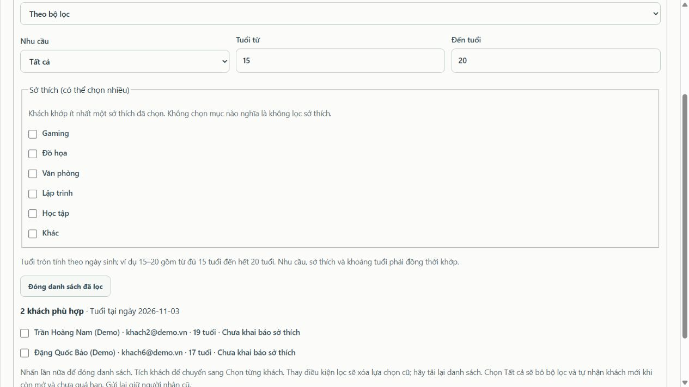

# Lọc và chọn người nhận khảo sát

Cập nhật **04/11/2026**.

## Hành vi mới

1. Chọn nhu cầu, sở thích và khoảng tuổi mong muốn. Khi nhập bộ lọc ở phạm vi Tất cả, giao diện tự chuyển sang Theo bộ lọc để tránh gửi vượt đối tượng.
2. Sở thích cho chọn nhiều. Khách có **ít nhất một sở thích** được chọn thì khớp; khách có thêm sở thích khác vẫn được nhận. Không chọn sở thích nghĩa là không giới hạn sở thích.
3. Khoảng tuổi tính tuổi tròn theo đầy đủ ngày sinh tại ngày MySQL của server. **15–20** gồm người vừa đủ 15 tuổi đến hết tuổi 20; người 14 tuổi, vừa đủ 21 tuổi hoặc thiếu ngày sinh hợp lệ không thuộc nhóm. Nhu cầu, sở thích và tuổi phải đồng thời khớp.
4. Bấm **Tải danh sách để chọn từng khách** lần đầu để mở danh sách đã lọc. Danh sách có số khách, tuổi và sở thích để đối chiếu. Bấm cùng nút lần hai để đóng; bấm tiếp sẽ tải lại danh sách theo điều kiện hiện tại.
5. Phạm vi **Tất cả** tích sẵn toàn bộ khách hợp lệ; **Theo bộ lọc** tích sẵn toàn bộ khách khớp điều kiện. **Chọn từng khách** chỉ tích những khách đã chọn/lưu. Tải hoặc mở lại danh sách không tự đổi phạm vi. Nếu Quản lý thay đổi dấu tích, phạm vi chuyển sang Chọn từng khách để gửi đúng tập được tích. Đóng danh sách giữ lựa chọn; đổi điều kiện lọc sẽ xóa danh sách và lựa chọn cũ, cần tải lại.
6. Đã bỏ nút **Xem trước người nhận**. Danh sách đã lọc là nơi xem và chọn người nhận.

Khi chọn lại phạm vi Tất cả, giao diện xóa bộ lọc và lựa chọn cũ. Khi gửi theo Chọn từng khách, backend vẫn kiểm tra tất cả ID theo tuổi, sở thích, nhu cầu và trạng thái ACTIVE hiện tại. Không thể sửa payload để chọn người ngoài bộ lọc. Nếu hồ sơ thay đổi và không còn khớp, thao tác gửi bị từ chối để Quản lý tải lại.

Phạm vi được lưu trong bản nháp và cố định khi mở. Phiếu mới đã OPEN không có bước bổ sung người nhận. Chỉ dữ liệu cũ thiếu phạm vi được thiết lập một lần và giữ người nhận trước đó. Nếu chưa có ai trả lời, có thể về DRAFT, sửa phạm vi rồi mở lại với tập người nhận mới. Xem [quy trình bắt buộc phạm vi](PHAM_VI_BAT_BUOC_KHAO_SAT.md).

## Nguyên nhân đã sửa

Nút tải danh sách trước đây gọi API khách hàng với duy nhất `status=ACTIVE`, bỏ qua nhu cầu/sở thích/tuổi đang nhập. Nay nút gọi bộ lọc dùng chung với xử lý gửi khảo sát. Danh sách và việc gửi đều xác thực cùng quy tắc; phản hồi tải chậm bị bỏ qua nếu bộ lọc, tài khoản hoặc màn hình đã thay đổi.

Không thay schema hay dữ liệu khách hàng hiện có. Máy chủ cổng 3000 đã khởi động lại; tải lại trang để nhận giao diện mới.

## Kiểm chứng

Điều chỉnh tích sẵn ngày 04/11/2026: **139/139 kiểm thử mã đạt**. Có ca riêng cho Tất cả / Theo bộ lọc / Chọn từng khách, kiểm tra số ô được tích, giữ nguyên phạm vi khi tải và giữ lựa chọn khi đóng/mở lại. Nhật ký `outputs/qa/tests-audience-auto-check.txt`. Không đổi API gửi, database hoặc dữ liệu đang dùng.

- Kiểm thử mã: **129/129 đạt**; nhật ký `outputs/qa/tests-audience-filter.txt`.
- HTTP/MySQL trên DB cách ly: **176/176 đạt**; `outputs/qa/integration-audience-filter.txt` và `outputs/qa/detailed-results.json`.
- FILTER01–FILTER04 đối chiếu ngày vừa đủ 15, chưa đến sinh nhật 15, đủ 20, chưa đến sinh nhật 21, vừa đủ 21, nhiều sở thích và thiếu ngày sinh; so sánh tập hiển thị với tập ghi vào `survey_recipients`; chặn ID chọn thủ công không khớp.
- Kiểm thử giao diện mô phỏng xác nhận mở/đóng/mở lại, giữ lựa chọn khi đóng, xóa lựa chọn khi đổi lọc, bỏ kết quả tải cũ và không còn nút xem trước.
- Đã thử trực tiếp trên trình duyệt: lọc 15–20 không giới hạn sở thích trả đúng hai khách mẫu **17 và 19 tuổi**; chọn Gaming/Đồ họa khi hai khách này chưa khai báo sở thích trả đúng 0 khách. Nhấp lần hai đóng danh sách thành công.

