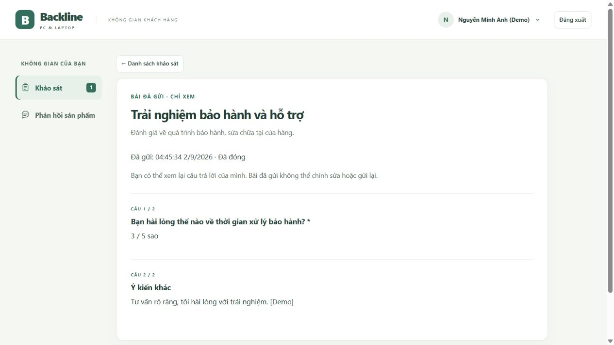

# Khách hàng xem lại bài khảo sát đã gửi

Cập nhật ngày **01/11/2026**.

## Cách sử dụng

1. Đăng nhập tài khoản khách hàng và vào **Khảo sát**.
2. Tại mục **Đã hoàn thành**, bấm **Xem bài đã gửi** trên phiếu đã trả lời.
3. Xem tiêu đề, mô tả, ngày giờ gửi, trạng thái hiện tại và câu trả lời của từng câu hỏi.
4. Bấm **Danh sách khảo sát** để quay lại.

Khảo sát đã đóng vẫn có trong lịch sử của người đã nộp. Nếu đã ẩn phiếu, vào **Xem khảo sát đã ẩn**; nút xem bài vẫn có ở đó. Phiếu quá hạn nhưng chưa nộp không có nút xem bài đã gửi.

## Quy tắc dữ liệu

- Hiển thị đáp án chọn một, nhiều lựa chọn, văn bản và số sao. Câu tùy chọn không trả lời ghi **Chưa trả lời**.
- Màn hình chỉ đọc, không có nút sửa hoặc gửi lại. Việc xem không ghi thay đổi vào database.
- Khách chỉ xem được bài của chính mình. API lấy ID khách từ phiên đăng nhập, bỏ qua `customerId` hoặc `responseId` giả mạo trên URL.
- Đường dẫn `GET /api/surveys/:id/my-response` trả 401 nếu chưa đăng nhập, 403 nếu dùng tài khoản nhân viên và 404 nếu khách không có bài đã gửi cho phiếu đó.
- Đóng hoặc ẩn khảo sát ở phía Quản lý không xóa quyền xem bài đã nộp. Quyền này dựa trên bản ghi nộp bài; kể cả thay đổi danh sách người nhận về sau, chủ bài vẫn xem được lịch sử của mình.
- Không hiển thị bài của khách khác, số liệu tổng hợp, mật khẩu hoặc thông tin khôi phục. Dữ liệu API được đánh dấu `Cache-Control: no-store`; nội dung câu hỏi/đáp án được escape khi hiển thị.
- Câu hỏi lấy từ dữ liệu khảo sát đang lưu. Luồng sửa hiện tại đã khóa sửa nội dung khi có bài trả lời; đây không phải cơ chế chụp phiên bản độc lập để chống chỉnh dữ liệu trực tiếp ngoài ứng dụng.

## Nghiệm thu

Đã kiểm tra API thật trên database cách ly: đọc đủ các loại đáp án; đọc lại sau khi CLOSED và ẩn; giữ lịch sử sau khi bỏ liên kết người nhận trong DB thử; chặn truy cập chéo tài khoản và giả mạo ID; xem không thay đổi số bản ghi; không cho sửa hoặc nộp lại bài đã đóng.

Kiểm thử giao diện mô phỏng gồm nút xem trên danh sách thường/đã ẩn, câu bỏ trống, escape nội dung và bỏ qua phản hồi tải chậm sau khi thoát màn hình hoặc đổi tài khoản.

- `npm test`: **121/121 đạt**.
- `node outputs/qa/detailed-system-check.cjs`: **167/167 đạt**, gồm bốn nhóm nghiệm thu KH01–KH04 cho chức năng này.
- Nhật ký: `outputs/qa/tests-survey-review.txt`, `outputs/qa/integration-survey-review.txt` và `outputs/qa/detailed-results.json`.

Không cần migration hoặc sửa dữ liệu khách hiện có. Cần khởi động lại máy chủ và tải lại trang để dùng mã mới.

Máy chủ cổng 3000 đã được khởi động lại. Đã đăng nhập khách mẫu trên trình duyệt, mở bài “Trải nghiệm bảo hành và hỗ trợ” ở trạng thái **Đã đóng** và xác nhận hiển thị đúng số sao, nội dung văn bản, không có trường chỉnh sửa hoặc nút nộp bài.

