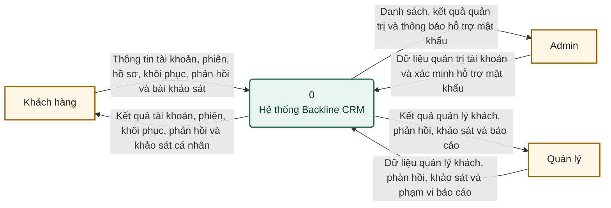
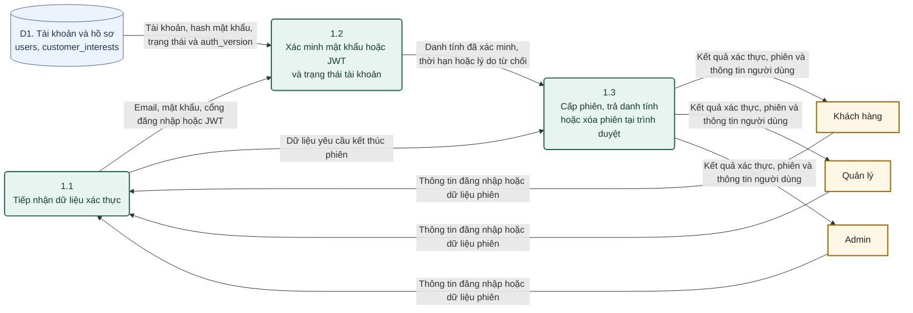
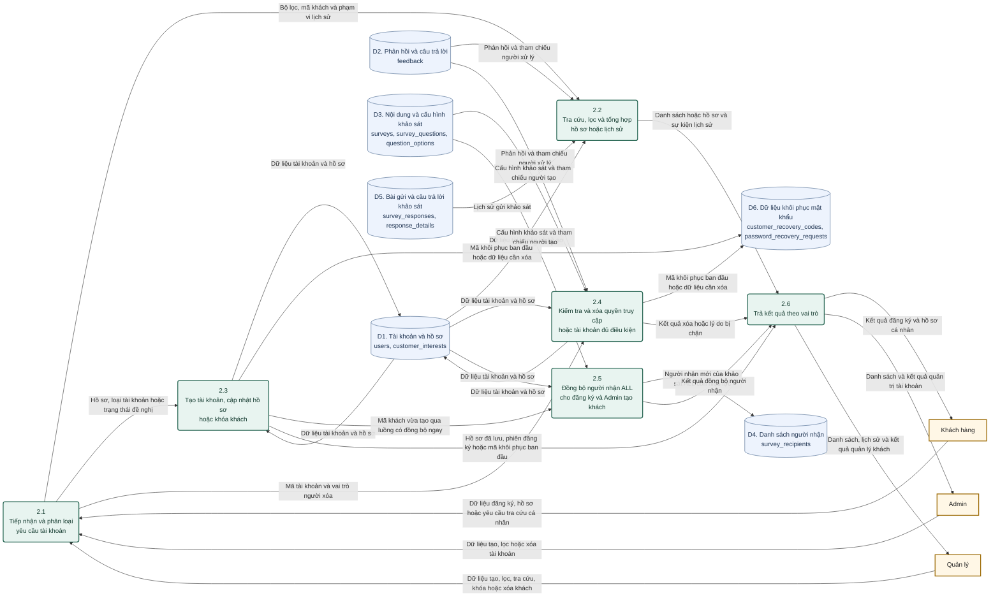
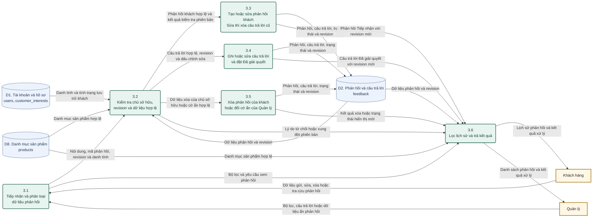
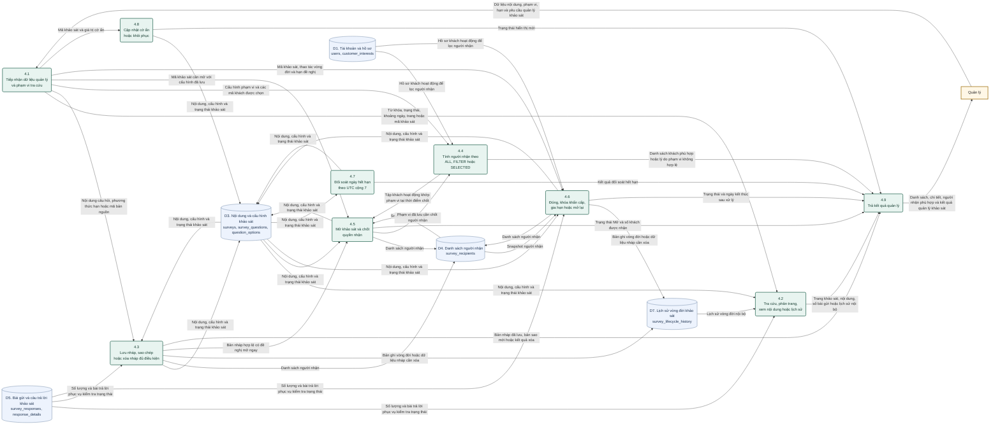
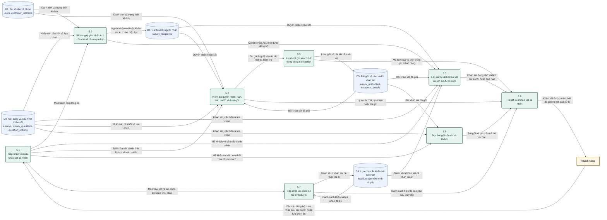
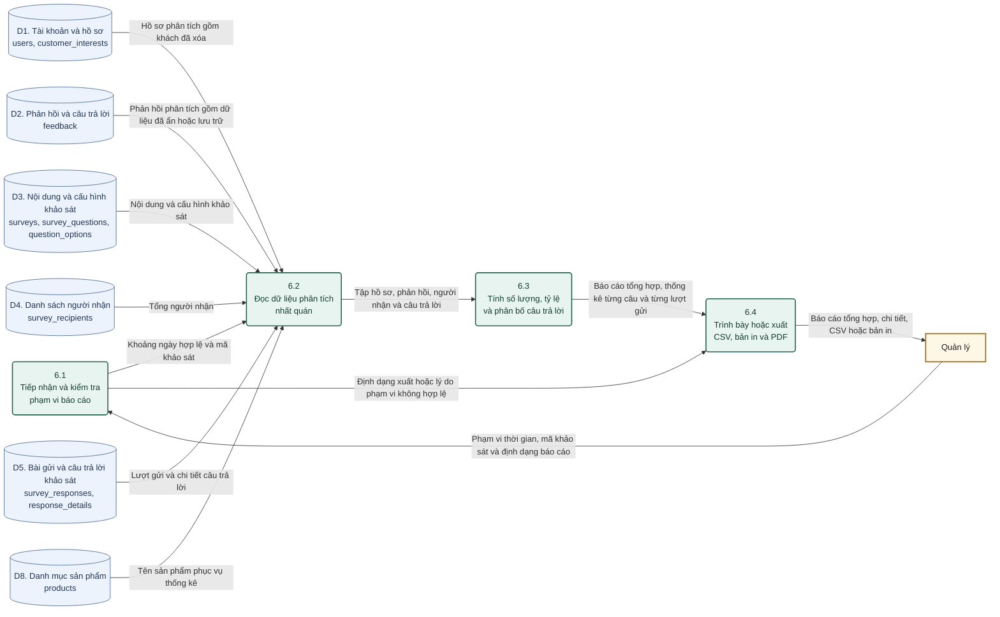
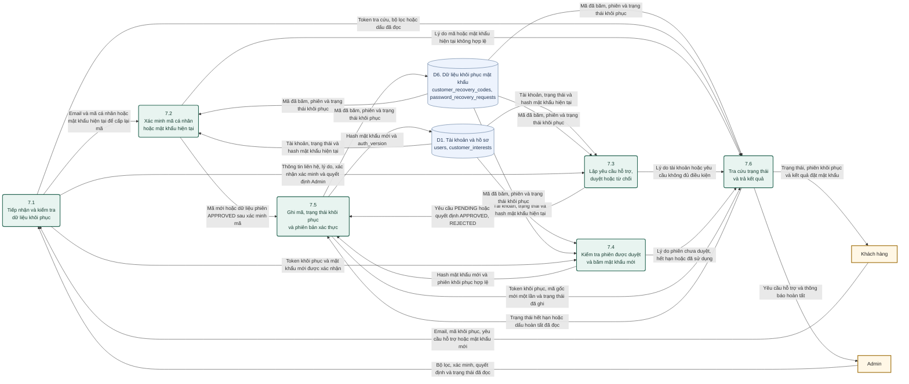

# DFD mức đỉnh và dưới đỉnh — Backline CRM

Đối chiếu mã nguồn ngày **09/11/2026**. Bộ sơ đồ dùng Mermaid `flowchart` để biểu diễn **luồng dữ liệu DFD**, không phải lưu đồ thuật toán. Các file `.mmd` đi kèm chỉ chứa mã Mermaid để dán riêng vào draw.io.

## 1. Chọn đúng cấp sơ đồ

| Cấp | Nội dung | File |
|---|---|---|
| Ngữ cảnh | Một tiến trình đại diện hệ thống, ba tác nhân ngoài | [00_ngu_canh.mmd](dfd/00_ngu_canh.mmd) |
| Mức đỉnh | Phân rã hệ thống thành 1.0–7.0 và các kho dữ liệu | [01_muc_dinh.mmd](dfd/01_muc_dinh.mmd) |
| Dưới đỉnh 1.0 | Xác thực và quản lý phiên | [02_duoi_dinh_1_xac_thuc.mmd](dfd/02_duoi_dinh_1_xac_thuc.mmd) |
| Dưới đỉnh 2.0 | Tài khoản, hồ sơ và xóa khách giữ lịch sử | [03_duoi_dinh_2_tai_khoan.mmd](dfd/03_duoi_dinh_2_tai_khoan.mmd) |
| Dưới đỉnh 3.0 | Phản hồi khách và câu trả lời Quản lý | [04_duoi_dinh_3_phan_hoi.mmd](dfd/04_duoi_dinh_3_phan_hoi.mmd) |
| Dưới đỉnh 4.0 | Nội dung, phạm vi người nhận và vòng đời khảo sát | [05_duoi_dinh_4_quan_ly_khao_sat.mmd](dfd/05_duoi_dinh_4_quan_ly_khao_sat.mmd) |
| Dưới đỉnh 5.0 | Đồng bộ, làm khảo sát, xem lại và ẩn cá nhân | [06_duoi_dinh_5_lam_khao_sat.mmd](dfd/06_duoi_dinh_5_lam_khao_sat.mmd) |
| Dưới đỉnh 6.0 | Đọc, tính và xuất báo cáo | [07_duoi_dinh_6_bao_cao.mmd](dfd/07_duoi_dinh_6_bao_cao.mmd) |
| Dưới đỉnh 7.0 | Khôi phục mật khẩu qua mã hoặc Admin | [08_duoi_dinh_7_khoi_phuc_mat_khau.mmd](dfd/08_duoi_dinh_7_khoi_phuc_mat_khau.mmd) |

**Quy ước tên cấp trong tài liệu:** ngữ cảnh đứng riêng; mức đỉnh là bản phân rã có các tiến trình 1.0–7.0; dưới đỉnh là các bản 1.1, 1.2… đến 7.1, 7.2… Một số giáo trình gọi các cấp bằng số khác nhau, vì vậy cần nhìn nội dung phân rã thay vì chỉ tên “Level 0”.

## 2. Cách nhập vào draw.io

1. Tạo một bản vẽ trong draw.io/diagrams.net.
2. Mở mục **Arrange → Insert → Mermaid**. Với giao diện/phiên bản cũ, mục Mermaid có thể nằm trong **Arrange → Insert → Advanced → Mermaid**.
3. Mở một file `.mmd`, sao chép **toàn bộ nội dung** rồi dán vào hộp Mermaid. File `.mmd` đã không có dấu bao Markdown.
4. Chèn sơ đồ; mỗi sơ đồ nên nằm trên một trang riêng. Không dán cả chín file thành một khối Mermaid.
5. Nếu sao chép từ phần mã phía dưới tài liệu này, chỉ lấy từ dòng `flowchart LR` đến hết mã, bỏ hai dòng dấu bao ` ```mermaid ` và ` ``` `.
6. Để trình bày báo cáo, dùng trang ngang và tăng khổ trang cho sơ đồ mức đỉnh/4.0. Chỉnh vị trí các khối sau khi chèn nếu phiên bản draw.io hỗ trợ chuyển thành các hình chỉnh sửa được.

Đây là mã Mermaid để chèn qua chức năng Mermaid; **không phải XML `.drawio` để mở trực tiếp bằng File → Open**. Khả năng chỉnh từng hình hoặc chỉnh lại mã phụ thuộc chế độ chèn và phiên bản draw.io.

Nguồn hướng dẫn nhập: [Insert and edit a Mermaid diagram — draw.io](https://www.drawio.com/docs/manual/mermaid/), [Insert Mermaid code — draw.io](https://www.drawio.com/docs/manual/insert/insert-mermaid/).

## 3. Quy ước ký hiệu DFD

| Hình/mã | Ý nghĩa |
|---|---|
| Chữ nhật vàng `KH`, `QL`, `AD` | Tác nhân ngoài: Khách hàng, Quản lý, Admin |
| Chữ nhật bo góc xanh lá `P...` | Tiến trình xử lý dữ liệu, có mã và tên động từ |
| Hình trụ xanh dương `D...` | Kho dữ liệu logic; ghi tên bảng tương ứng hoặc nơi lưu |
| Mũi tên một chiều có nhãn | Dữ liệu đi từ nguồn đến nơi nhận |

Mermaid không có bộ ký hiệu DFD Gane–Sarson/Yourdon chuyên dụng trong cú pháp cơ bản. Hình trụ được dùng làm ký hiệu thay thế rõ nghĩa cho kho dữ liệu. Nếu quy định của môn học yêu cầu kho hai đường song song/hình chữ nhật hở, hãy đổi riêng hình kho sau khi nhập draw.io; giữ nguyên mã, tên và mũi tên.

Các quy tắc được giữ trong bộ sơ đồ:

- Không nối trực tiếp tác nhân với kho dữ liệu.
- Không nối trực tiếp hai kho dữ liệu.
- Tiến trình có dữ liệu đầu vào và đầu ra.
- Mọi mũi tên có nhãn là dữ liệu; không dùng “đúng/sai”, “bấm tiếp”, “thành công thì chạy” làm nhánh điều khiển.
- Giữ mã kho D1–D9 thống nhất giữa các cấp.
- Các luồng tại biên của từng tiến trình mức đỉnh được giữ khi phân rã dưới đỉnh. Một luồng tổng hợp có thể cấp cho nhiều tiến trình con khi các tiến trình đó dùng cùng loại dữ liệu.

**Cách đọc quan trọng:** mũi tên A → B nghĩa là B nhận dữ liệu từ A; không khẳng định A phải chạy xong rồi B mới chạy theo thứ tự thời gian. Muốn mô tả thứ tự gọi frontend/backend hoặc rẽ nhánh điều kiện, cần sequence diagram/activity diagram riêng.

## 4. Ranh giới hệ thống và phạm vi mô hình

Hệ thống được mô hình hóa gồm frontend CRM, backend Node.js/Express và dữ liệu được ứng dụng sử dụng. Vì có frontend, D9 localStorage được ghi rõ là kho tại trình duyệt, không nhầm thành bảng MySQL.

- Ba vai trò là ba **tác nhân nghiệp vụ**. Backend, service, trình duyệt và MySQL không được thêm thành các tác nhân ngoài ở sơ đồ mức đỉnh.
- JWT/cookie được thể hiện trong dữ liệu phiên trả cho người dùng qua giao diện. Không có bảng `sessions` riêng trong triển khai hiện tại.
- API nghiệp vụ có xác thực/phân quyền theo mã nguồn. Để sơ đồ dễ đọc, không vẽ lặp lại bảy mũi tên xin xác thực giữa mọi tiến trình; dữ liệu yêu cầu nghiệp vụ được hiểu là kèm danh tính/phiên tương ứng và kiểm tra quyền tại backend.
- Bộ hẹn giờ/đối soát hết hạn là xử lý nội bộ 4.7, dùng ngày UTC+7; không phải tác nhân người dùng thứ tư. Khởi động, trước API và hẹn giờ có thể kích hoạt đối soát.
- Các nút mở/đóng dialog, giữ vị trí cuộn, con mắt mật khẩu không tạo nhóm nghiệp vụ mới trong DFD. Phân trang/bộ lọc được thể hiện bằng dữ liệu yêu cầu/đáp ứng.
- Script cài đặt, sao lưu/phục hồi là vận hành kỹ thuật ngoài phạm vi DFD nghiệp vụ này. Không thêm thanh toán, đơn hàng, gửi OTP/email/SMS hoặc chức năng chưa có.
- Sơ đồ là phân rã **logic nghiệp vụ**, không khẳng định mỗi tiến trình tương ứng đúng một class/service/file JavaScript. Một route có thể thực hiện nhiều phần xử lý; các bước ghi dữ liệu liên quan vẫn nằm trong transaction thật của hệ thống.

## 5. Từ điển kho dữ liệu

| Kho | Bảng/nơi lưu | Dữ liệu và lưu ý |
|---|---|---|
| D1 | `users`, `customer_interests` | Tài khoản, hash mật khẩu, vai trò, trạng thái, `auth_version`, hồ sơ, nhiều sở thích, `erased_at` |
| D2 | `feedback` | Nội dung khách, sản phẩm liên quan, số sao, trạng thái, reply, người/thời điểm trả lời, revision, cờ ẩn |
| D3 | `surveys`, `survey_questions`, `question_options` | Tiêu đề/mô tả, câu hỏi/lựa chọn, trạng thái, ngày kết thúc, phạm vi, cờ nhận khách mới, cờ ẩn và dấu tự hết hạn |
| D4 | `survey_recipients` | Danh sách khách được nhận từng khảo sát |
| D5 | `survey_responses`, `response_details` | Lượt gửi của khách và chi tiết câu trả lời |
| D6 | `customer_recovery_codes`, `password_recovery_requests` | Mã đã băm, token khôi phục đã băm, trạng thái yêu cầu, hạn và ghi chú xác minh |
| D7 | `survey_lifecycle_history` | Đóng, khóa khẩn cấp, gia hạn, mở lại và người xử lý; không phải lịch sử mọi lần sửa nội dung |
| D8 | `products` | Sản phẩm có thật dùng để kiểm tra và hiển thị/tổng hợp phản hồi |
| D9 | localStorage tại trình duyệt | Các mã khảo sát khách tự ẩn, phân biệt theo tài khoản; không đồng bộ thành dữ liệu MySQL |

Gom nhiều bảng vào một kho là để biểu diễn dữ liệu logic ở mức đỉnh. Đây không phải ERD; sơ đồ không mô tả khóa ngoại hoặc cột theo kiểu thiết kế bảng.

## 6. Các điều kiện nghiệp vụ cần đọc cùng sơ đồ

### 6.1. Xác thực và tài khoản

- Đăng nhập dùng **email và mật khẩu**. Backend kiểm tra bcrypt, trạng thái hoạt động và cổng/vai trò.
- Cookie khách là HttpOnly. Admin/Quản lý dùng Bearer token từ sessionStorage.
- Token cũ bị chặn tại API khi tài khoản không hoạt động hoặc `auth_version` không còn khớp. Đăng xuất hiện dọn cookie/token phía trình duyệt, không có kho blacklist JWT toàn cục.
- Admin tạo khách và Quản lý tạo khách đều không còn Nhu cầu/Sở thích trên form tạo. Khách tự bổ sung sau; nhu cầu ban đầu “Chưa xác định”, sở thích rỗng.
- Cả hai form tạo khách nhận ngày sinh nhập tay `dd/mm/yyyy`. Form Quản lý vẫn cho phép hồ sơ ban đầu thiếu địa chỉ/ngày sinh/giới tính; form Admin kiểm tra đầy đủ hơn.

### 6.2. Xóa khách giữ dữ liệu

- Admin được xóa trực tiếp khách; Quản lý phải khóa khách trước.
- Xóa email, điện thoại, hash mật khẩu, địa chỉ và dữ liệu khôi phục liên quan; đánh dấu xóa, vô hiệu hóa đăng nhập.
- Giữ tên, ngày sinh, giới tính, nhu cầu, sở thích, phản hồi và câu trả lời, quyền nhận khảo sát, bài gửi và chi tiết; giữ khóa định danh và metadata cần cho liên kết dữ liệu. Trường năm sinh phụ bị làm rỗng, nhưng ngày sinh vẫn còn.
- **Không có luồng xóa D2, D4, D5 trong chức năng xóa khách.** D3 cũng được giữ. Các kho vẫn được 6.0 đọc để báo cáo.
- Khách đã xóa biến mất khỏi tài khoản, khách hàng, hồ sơ/lịch sử và phản hồi vận hành; Tổng quan cũng loại khách đã xóa.
- Admin xóa tài khoản nhân viên là nhánh khác: kiểm tra tự xóa, Admin cuối cùng và tham chiếu người tạo khảo sát/người xử lý phản hồi trước khi xóa thật tài khoản được phép.

### 6.3. Phản hồi

- Khách gửi: `NEW`/Tiếp nhận. Quản lý trả lời hoặc sửa câu trả lời: `RESOLVED`/Đã giải quyết.
- Khách sửa: kiểm tra chủ sở hữu và revision, xóa reply cũ, bỏ cờ ẩn và quay về NEW.
- Khách xóa phản hồi: xóa thật bản ghi, reply trong bản ghi bị xóa theo. Đây khác hoàn toàn xóa tài khoản khách.
- Quản lý chỉnh sửa reply cần dấu `editReply` và revision phù hợp; không tạo chuỗi tin nhắn chat.
- Quản lý chỉ ẩn/khôi phục phản hồi đã giải quyết của khách chưa xóa. Báo cáo vẫn tính dữ liệu đã ẩn/lưu trữ.

### 6.4. Người nhận và vòng đời khảo sát

| Vấn đề | Quy tắc thực tế |
|---|---|
| ALL | Khách hoạt động hiện tại; tự bổ sung khách mới khi còn mở/còn hạn |
| FILTER | Chốt tất cả khách khớp bộ lọc tại lúc mở; không tự thêm khách mới mãi |
| SELECTED | Chốt các khách được chọn hợp lệ, khớp bộ lọc kèm theo |
| Nhiều sở thích | Khớp ít nhất một sở thích được chọn; nhu cầu và tuổi vẫn phải đồng thời khớp |
| Tuổi 15–20 | Từ đủ 15 đến hết 20, tính đủ ngày/tháng sinh |
| Tích/bỏ tích trong danh sách | Chuyển sang SELECTED; tích lại đủ không tự trở về FILTER |
| Mở nháp | Phải có phạm vi hợp lệ, người nhận hoạt động phù hợp, hạn chưa quá |
| Khóa khẩn cấp | Chỉ OPEN chưa có bài gửi; về DRAFT, giữ cấu hình để sửa |
| Có ngày kết thúc | Hết ngày đã chọn theo UTC+7; từ 00:00 ngày tiếp theo đóng |
| Đóng thủ công | Không có ngày; nhận đến khi Quản lý đóng theo luồng hợp lệ |
| Gia hạn trên UI | Khảo sát OPEN có ngày kết thúc; ngày mới muộn hơn hạn hiện tại |
| Mở lại | CLOSED có phạm vi và người nhận; giữ bài cũ, ALL thêm khách mới, FILTER/SELECTED giữ snapshot |
| Gửi lần hai | Không cho cùng khách gửi lại cùng khảo sát, kể cả đã mở lại |
| Lập khảo sát | Tạo nháp độc lập; không chép phạm vi, người nhận, hạn và bài gửi cũ |
| Xóa nháp | Chỉ DRAFT không có bài gửi, xóa các thành phần nháp liên quan trong transaction |
| Ẩn khảo sát | Cờ hiển thị Quản lý lưu DB; không đồng nghĩa đóng và không loại khỏi báo cáo |
| Khách tự ẩn | Chỉ D9 ở trình duyệt, không xóa D3/D5 |

“Gửi khảo sát” là ghi quyền nhận vào D4. Không có mũi tên gửi email/SMS vì luồng publish không triển khai chức năng đó. Khảo sát cũ OPEN chưa cấu hình có nhánh hỗ trợ thiết lập phạm vi; khảo sát mới đã có phạm vi không bổ sung tùy ý sau mở.

### 6.5. Khôi phục và báo cáo

- Khôi phục bằng mã: email/mã đúng tạo phiên APPROVED 15 phút; mã được băm, không lưu mã gốc để Admin xem.
- Thủ công: yêu cầu PENDING 30 phút, Admin xác minh và duyệt thì khách có 15 phút đặt mật khẩu.
- Hoàn tất: cập nhật bcrypt, tăng auth_version, COMPLETED, hủy các yêu cầu khác còn hiệu lực, cấp mã mới; các thay đổi liên quan nằm trong transaction.
- Quản lý được xem báo cáo; Admin không được mặc nhiên truy cập nhóm báo cáo vì API có tiền tố `/api/admin`.
- Báo cáo đọc dữ liệu đã ẩn và khách đã xóa. Không có luồng báo cáo ghi ngược dữ liệu nghiệp vụ.
- Bộ lọc báo cáo theo ngày tạo tài khoản, ngày tiếp nhận phản hồi và ngày tạo khảo sát; hồ sơ/trạng thái là hiện tại, không phải snapshot quá khứ tại ngày lọc.
- CSV tạo từ dữ liệu báo cáo đã tải; In/Lưu PDF dùng hộp thoại in trình duyệt. Không phải backup SQL.

## 7. Đối chiếu tiến trình với mã nguồn

| Tiến trình | Nơi thực hiện chính |
|---|---|
| 1.0 | Route auth và middleware trong `server.mysql.js`, `customer-session.js`, giao diện `app.js`/`admin.js` |
| 2.0 | Route register/accounts/customers/me trong `server.mysql.js`, `customer-retention.js`, `customer-history.js`, `customer-interests.js`, `survey-enrollment.js`, `recovery-codes.js` |
| 3.0 | Route feedback trong `server.mysql.js`, `feedback-service.js`, `app.js`, `role-ui.js`, `staff-controller.js` |
| 4.0 | `survey-service.js`, `survey-audience.js`, `survey-lifecycle.js`, `survey-expiry.js`, `survey-copy.js`, `survey-visibility.js`, `staff-surveys.js` |
| 5.0 | Route surveys/survey-status/responses, `survey-enrollment.js`, `customer-survey-review.js`, `survey-service.js`, `app.js` |
| 6.0 | `reports-service.js`, `reports.js`; đọc dữ liệu lưu trữ thay vì loại như API vận hành |
| 7.0 | `password-recovery.js`, `recovery-codes.js`, `recovery-client.js`, `recovery-admin.js` |

`crm-validation.js`, `crm-domain.js`, `birth-date.js` cung cấp kiểm tra dùng chung. Phân quyền và xác thực được kiểm tra tại backend, không chỉ bằng việc ẩn nút giao diện.

## 8. Kiểm tra bộ sơ đồ

File [dfd/_kiem_tra_cau_truc.json](dfd/_kiem_tra_cau_truc.json) ghi kết quả kiểm tra cấu trúc và cân bằng biên cho bảy bản phân rã. Nội dung kiểm tra gồm mã nguồn/đích tồn tại, mọi luồng có nhãn, không nối trực tiếp tác nhân–kho hoặc kho–kho, tiến trình có đầu vào/đầu ra và bảo toàn các luồng tổng hợp của tiến trình cha.

Cả **9 file đã được phân tích cú pháp thành công bằng thư viện Mermaid**; phiên bản và kết quả từng file nằm tại [dfd/_kiem_tra_mermaid.json](dfd/_kiem_tra_mermaid.json). Đây là kiểm tra parser, chưa phải xác nhận đã nhập và kiểm tra bố cục trực tiếp trên từng phiên bản draw.io. Cú pháp chỉ dùng flowchart cơ bản, nhãn có dấu ngoặc kép và style để thuận tiện chèn bằng chức năng Mermaid.

Kiểm tra cấu trúc không thay thế việc đánh giá nghiệp vụ. Các điều kiện mục 6 và bảng đối chiếu mã nguồn mục 7 giải thích những quy tắc không thể hiện bằng đường rẽ nhánh trên DFD.

## 9. Mã Mermaid của từng sơ đồ

Mỗi khối dưới đây là một sơ đồ độc lập. Nếu ứng dụng đọc Markdown của bạn không render Mermaid, vẫn có thể sao chép mã vào draw.io hoặc mở trực tiếp file `.mmd` tương ứng.

### Sơ đồ ngữ cảnh — toàn hệ thống

**Mã nguồn Mermaid:** [00_ngu_canh.mmd](dfd/00_ngu_canh.mmd).

Chỉ có ba tác nhân và một tiến trình hệ thống; không đưa kho dữ liệu nội bộ vào sơ đồ ngữ cảnh.



### DFD mức đỉnh — các tiến trình 1.0 đến 7.0

**Mã nguồn Mermaid:** [01_muc_dinh.mmd](dfd/01_muc_dinh.mmd).

Phân rã hệ thống thành bảy nhóm xử lý; kho được gom theo nghiệp vụ, không phải một hình cho mỗi bảng SQL. D9 nằm tại trình duyệt.

```mermaid
flowchart LR
  KH["Khách hàng"]
  QL["Quản lý"]
  AD["Admin"]
  D1[("D1. Tài khoản và hồ sơ<br/>users, customer_interests")]
  D2[("D2. Phản hồi và câu trả lời<br/>feedback")]
  D3[("D3. Nội dung và cấu hình khảo sát<br/>surveys, survey_questions, question_options")]
  D4[("D4. Danh sách người nhận<br/>survey_recipients")]
  D5[("D5. Bài gửi và câu trả lời khảo sát<br/>survey_responses, response_details")]
  D6[("D6. Dữ liệu khôi phục mật khẩu<br/>customer_recovery_codes, password_recovery_requests")]
  D7[("D7. Lịch sử vòng đời khảo sát<br/>survey_lifecycle_history")]
  D8[("D8. Danh mục sản phẩm<br/>products")]
  D9[("D9. Lựa chọn ẩn khảo sát cá nhân<br/>localStorage trên trình duyệt")]
  P1("1.0<br/>Xác thực và quản lý phiên")
  P2("2.0<br/>Quản lý tài khoản và hồ sơ")
  P3("3.0<br/>Quản lý phản hồi")
  P4("4.0<br/>Quản lý và phân phối khảo sát")
  P5("5.0<br/>Thực hiện và tra cứu khảo sát cá nhân")
  P6("6.0<br/>Tổng hợp và xuất báo cáo")
  P7("7.0<br/>Khôi phục mật khẩu")

  KH -->|"Thông tin đăng nhập hoặc dữ liệu phiên"| P1
  QL -->|"Thông tin đăng nhập hoặc dữ liệu phiên"| P1
  AD -->|"Thông tin đăng nhập hoặc dữ liệu phiên"| P1
  P1 -->|"Kết quả xác thực, phiên và thông tin người dùng"| KH
  P1 -->|"Kết quả xác thực, phiên và thông tin người dùng"| QL
  P1 -->|"Kết quả xác thực, phiên và thông tin người dùng"| AD
  D1 -->|"Tài khoản, hash mật khẩu, trạng thái và auth_version"| P1
  KH -->|"Dữ liệu đăng ký, hồ sơ hoặc yêu cầu tra cứu cá nhân"| P2
  AD -->|"Dữ liệu tạo, lọc hoặc xóa tài khoản"| P2
  QL -->|"Dữ liệu tạo, lọc, tra cứu, khóa hoặc xóa khách"| P2
  P2 -->|"Kết quả đăng ký và hồ sơ cá nhân"| KH
  P2 -->|"Danh sách và kết quả quản trị tài khoản"| AD
  P2 -->|"Danh sách, lịch sử và kết quả quản lý khách"| QL
  D1 -->|"Dữ liệu tài khoản và hồ sơ"| P2
  P2 -->|"Dữ liệu tài khoản và hồ sơ"| D1
  D2 -->|"Phản hồi và tham chiếu người xử lý"| P2
  D3 -->|"Cấu hình khảo sát và tham chiếu người tạo"| P2
  D5 -->|"Lịch sử gửi khảo sát"| P2
  P2 -->|"Người nhận mới của khảo sát ALL còn hiệu lực"| D4
  P2 -->|"Mã khôi phục ban đầu hoặc dữ liệu cần xóa"| D6
  KH -->|"Dữ liệu gửi, sửa, xóa hoặc tra cứu phản hồi"| P3
  QL -->|"Bộ lọc, câu trả lời hoặc dữ liệu ẩn phản hồi"| P3
  P3 -->|"Lịch sử phản hồi và kết quả xử lý"| KH
  P3 -->|"Danh sách phản hồi và kết quả xử lý"| QL
  D1 -->|"Danh tính và tình trạng lưu trữ khách"| P3
  D2 -->|"Dữ liệu phản hồi và revision"| P3
  P3 -->|"Phản hồi, câu trả lời, trạng thái và revision"| D2
  D8 -->|"Danh mục sản phẩm hợp lệ"| P3
  QL -->|"Dữ liệu nội dung, phạm vi, hạn và yêu cầu quản lý khảo sát"| P4
  P4 -->|"Danh sách, chi tiết, người nhận phù hợp và kết quả quản lý khảo sát"| QL
  D1 -->|"Hồ sơ khách hoạt động để lọc người nhận"| P4
  D3 -->|"Nội dung, cấu hình và trạng thái khảo sát"| P4
  P4 -->|"Nội dung, cấu hình và trạng thái khảo sát"| D3
  D4 -->|"Snapshot người nhận"| P4
  P4 -->|"Danh sách người nhận"| D4
  D5 -->|"Số lượng và bài trả lời phục vụ kiểm tra trạng thái"| P4
  D7 -->|"Lịch sử vòng đời nội bộ"| P4
  P4 -->|"Bản ghi vòng đời hoặc dữ liệu nháp cần xóa"| D7
  KH -->|"Yêu cầu đồng bộ, xem khảo sát, bài trả lời hoặc lựa chọn ẩn"| P5
  P5 -->|"Khảo sát được nhận, bài đã gửi và kết quả xử lý"| KH
  D1 -->|"Danh tính và trạng thái khách"| P5
  D3 -->|"Khảo sát, câu hỏi và lựa chọn"| P5
  D4 -->|"Quyền nhận khảo sát"| P5
  P5 -->|"Người nhận mới của khảo sát ALL còn hiệu lực"| D4
  D5 -->|"Bài khảo sát đã gửi"| P5
  P5 -->|"Lượt gửi và chi tiết câu trả lời"| D5
  D9 -->|"Danh sách khảo sát cá nhân đã ẩn"| P5
  P5 -->|"Danh sách khảo sát cá nhân đã ẩn"| D9
  QL -->|"Phạm vi thời gian, mã khảo sát và định dạng báo cáo"| P6
  P6 -->|"Báo cáo tổng hợp, chi tiết, CSV hoặc bản in"| QL
  D1 -->|"Hồ sơ phân tích gồm khách đã xóa"| P6
  D2 -->|"Phản hồi phân tích gồm dữ liệu đã ẩn hoặc lưu trữ"| P6
  D3 -->|"Nội dung và cấu hình khảo sát"| P6
  D4 -->|"Tổng người nhận"| P6
  D5 -->|"Lượt gửi và chi tiết câu trả lời"| P6
  D8 -->|"Tên sản phẩm phục vụ thống kê"| P6
  KH -->|"Email, mã khôi phục, yêu cầu hỗ trợ hoặc mật khẩu mới"| P7
  AD -->|"Bộ lọc, xác minh, quyết định và trạng thái đã đọc"| P7
  P7 -->|"Trạng thái, phiên khôi phục và kết quả đặt mật khẩu"| KH
  P7 -->|"Yêu cầu hỗ trợ và thông báo hoàn tất"| AD
  D1 -->|"Tài khoản, trạng thái và hash mật khẩu hiện tại"| P7
  P7 -->|"Hash mật khẩu mới và auth_version"| D1
  D6 -->|"Mã đã băm, phiên và trạng thái khôi phục"| P7
  P7 -->|"Mã đã băm, phiên và trạng thái khôi phục"| D6

  classDef entity fill:#fff7e6,stroke:#9a6700,color:#222,stroke-width:2px;
  classDef process fill:#e8f4f0,stroke:#276653,color:#153c30,stroke-width:2px;
  classDef store fill:#edf3fd,stroke:#46658c,color:#203552;
  class KH,QL,AD entity;
  class P1,P2,P3,P4,P5,P6,P7 process;
  class D1,D2,D3,D4,D5,D6,D7,D8,D9 store;
```



### Dưới đỉnh 1.0 — xác thực và phiên

**Mã nguồn Mermaid:** [02_duoi_dinh_1_xac_thuc.mmd](dfd/02_duoi_dinh_1_xac_thuc.mmd).

Khách nhận JWT trong cookie HttpOnly; Admin và Quản lý nhận token để lưu sessionStorage. Không có bảng session riêng. Đăng xuất hiện xóa phiên phía trình duyệt, không phải thu hồi mọi bản sao JWT.



### Dưới đỉnh 2.0 — tài khoản, hồ sơ và xóa khách giữ lịch sử

**Mã nguồn Mermaid:** [03_duoi_dinh_2_tai_khoan.mmd](dfd/03_duoi_dinh_2_tai_khoan.mmd).

Admin xóa khách trực tiếp; Quản lý phải khóa khách trước. Xóa khách không có mũi tên xóa D2/D3/D4/D5 vì các dữ liệu đó được giữ lại. Người tạo khảo sát/người trả lời phản hồi có ràng buộc khi Admin xóa tài khoản nhân viên. Khách do Quản lý tạo được đồng bộ ALL khi vào luồng 5.0.



### Dưới đỉnh 3.0 — sửa phản hồi và câu trả lời Quản lý

**Mã nguồn Mermaid:** [04_duoi_dinh_3_phan_hoi.mmd](dfd/04_duoi_dinh_3_phan_hoi.mmd).

Mỗi bản ghi feedback chứa một câu trả lời hiện tại, không phải luồng chat. Khách sửa: về NEW, xóa reply và bỏ ẩn. Quản lý sửa reply: vẫn RESOLVED. Khách xóa: xóa cả bản ghi và reply. Khách đã xóa tài khoản bị loại khỏi phản hồi vận hành nhưng báo cáo vẫn đọc dữ liệu lưu trữ.



### Dưới đỉnh 4.0 — nội dung, người nhận và vòng đời khảo sát

**Mã nguồn Mermaid:** [05_duoi_dinh_4_quan_ly_khao_sat.mmd](dfd/05_duoi_dinh_4_quan_ly_khao_sat.mmd).

4.7 là xử lý nội bộ theo thời gian UTC+7 tại startup, trước API và bộ hẹn giờ; không phải tác nhân thứ tư hay nút bấm. Phạm vi FILTER/SELECTED giữ snapshot khi mở lại; ALL được bổ sung khách hoạt động mới. Khảo sát Mở có bài gửi không được khóa khẩn cấp về Nháp. Lịch sử D7 chỉ nội bộ, không có nút ở màn hình kết quả.



### Dưới đỉnh 5.0 — đồng bộ, gửi và xem lại khảo sát

**Mã nguồn Mermaid:** [06_duoi_dinh_5_lam_khao_sat.mmd](dfd/06_duoi_dinh_5_lam_khao_sat.mmd).

D9 là dữ liệu trình duyệt, không phải bảng MySQL. Bài gửi có ràng buộc duy nhất theo khảo sát và khách. Mở lại không cho khách đã gửi làm lần hai. Danh sách khách có thể còn khảo sát tự hết hạn chưa làm, nhưng không có khảo sát Nháp.



### Dưới đỉnh 6.0 — báo cáo giữ dữ liệu lịch sử

**Mã nguồn Mermaid:** [07_duoi_dinh_6_bao_cao.mmd](dfd/07_duoi_dinh_6_bao_cao.mmd).

Chỉ Quản lý nhận báo cáo. Dữ liệu khách đã xóa và dữ liệu đã ẩn vẫn được đọc ở đây. Khách lọc theo ngày tạo, phản hồi theo ngày tiếp nhận, khảo sát theo ngày tạo; trạng thái/hồ sơ là hiện tại. Xuất CSV/in không ghi ngược kho nghiệp vụ.



### Dưới đỉnh 7.0 — mã cá nhân, Admin duyệt và đặt mật khẩu

**Mã nguồn Mermaid:** [08_duoi_dinh_7_khoi_phuc_mat_khau.mmd](dfd/08_duoi_dinh_7_khoi_phuc_mat_khau.mmd).

Mã cá nhân đúng tạo phiên APPROVED 15 phút; hỗ trợ thủ công tạo PENDING 30 phút, Admin duyệt mới được đặt mật khẩu trong 15 phút. Hoàn tất: bcrypt mới, tăng auth_version, COMPLETED, hủy yêu cầu khác và cấp mã mới. Token khôi phục không phải JWT đăng nhập. Không có OTP/email server hay gửi mật khẩu cho Admin.


